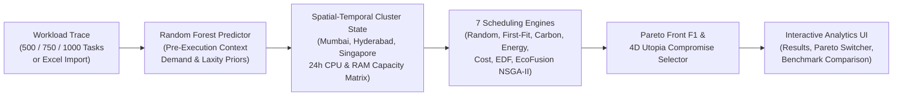

# EcoFusion: An AI-Driven Multi-Objective Workload Orchestration Framework for Sustainable Cloud Data Centers

## 1. Abstract

**EcoFusion** is an academic research simulation and optimization framework for spatial-temporal cloud workload orchestration across geographically distributed data centers. Modern cloud operators face conflicting operational goals: minimizing grid carbon emissions ($\text{kgCO}_2$), reducing total facility energy consumption ($\text{kWh}$), lowering Time-of-Use (ToU) operational electricity expenditure ($\text{USD}$), and satisfying strict Service Level Agreement (SLA) completion deadlines. Traditional single-objective heuristics optimize one parameter in isolation, creating severe performance blindspots in the remaining dimensions.

EcoFusion addresses this trade-off by combining a non-leaking **Random Forest Demand & Laxity Predictor** with a population-based **Non-Dominated Sorting Genetic Algorithm II (NSGA-II)** equipped with a deterministic CPU and Memory (RAM) Feasibility Repair operator. Evaluated under identical physical equations and strict multi-resource constraints across 500 heterogeneous workloads and 5 independent random seeds (`42, 101, 202, 303, 404`), EcoFusion discovers a diverse 4-objective Pareto frontier and selects a balanced compromise schedule using a transparent 4D Utopia Euclidean Distance criterion—achieving a single-seed composite balance score of **$79.2 / 100$** ($72.84 \pm 4.67$ across 5 seeds) and an SLA violation rate of **$0.8\%$** ($1.64 \pm 1.08\%$ across 5 seeds) while remaining competitive against single-metric specialists in carbon, energy, and cost.

---

## 2. Problem Statement & Research Motivation

Cloud computing infrastructure accounts for a rapidly growing share of global electricity demand and carbon emissions. When a batch or compute workload arrives at a multi-region cloud scheduler, the orchestrator must decide **where** (which regional data center pool $p \in \mathcal{P}$) and **when** (which time slot $t \in \mathcal{T}$) to execute the workload.

This decision is complicated by three physical realities:
1. **Spatial Heterogeneity:** Data centers in different regions exhibit distinct Power Usage Effectiveness ($\text{PUE}$), hardware idle/peak power profiles, baseline grid carbon intensities ($\text{gCO}_2/\text{kWh}$), and industrial electricity tariffs ($\$/\text{kWh}$).
2. **Temporal Diurnal Variation:** Within each 24-hour cycle, solar generation lowers grid carbon intensity during midday hours (`09:00–15:00`), ambient temperature increases cooling $\text{PUE}$ during hot afternoon hours, and utilities offer off-peak tariff discounts during night hours (`22:00–05:00`) when coal baseload predominates.
3. **Multi-Resource Contention & Strict Deadlines:** Workloads require contiguous CPU cores and RAM capacity between arrival time $a_w$ and deadline $\text{deadline}_w$. Greedily packing workloads into a single "cheapest" or "cleanest" window saturates cluster capacity and causes cascading SLA violations for latency-critical tasks.

---

## 3. Research Objectives & Contributions

### Primary Optimization Objectives
EcoFusion formulates cloud workload scheduling as a constrained 4-objective minimization problem:
$$\min_{\mathbf{x}} \mathbf{F}(\mathbf{x}) = \bigl[\; f_{\text{Carbon}}(\mathbf{x}),\; f_{\text{Energy}}(\mathbf{x}),\; f_{\text{Cost}}(\mathbf{x}),\; f_{\text{SLA}}(\mathbf{x}) \;\bigr]^T$$

1. **Minimize Carbon Emissions ($f_{\text{Carbon}}$, $\text{kgCO}_2$):** Reduce total greenhouse gas emissions across all scheduled workloads.
2. **Minimize Facility Energy Consumption ($f_{\text{Energy}}$, $\text{kWh}$):** Reduce PUE-adjusted server and cooling energy consumption.
3. **Minimize Operational Electricity Cost ($f_{\text{Cost}}$, $\text{USD}$):** Reduce total Time-of-Use utility expenditure.
4. **Minimize SLA Violations ($f_{\text{SLA}}$, $\%$):** Minimize the percentage of workloads that finish after their hard deadline or cannot be scheduled due to capacity exhaustion.

### Key Technical Contributions
- **Unified Spatial-Temporal Physical Evaluation Model:** Integrates proportional server idle power, utilization-dependent dynamic power, diurnal ambient thermal PUE offsets, regional solar/coal carbon intensity curves, and Time-of-Use electricity tariffs across every occupied execution hour $h \in [t_w, t_w + d_w - 1]$.
- **Leakage-Free Random Forest Context Prior Pipeline:** Estimates workload CPU, memory, and duration priors strictly from pre-execution arrival context (arrival hour, job domain/priority tier, and SLA slack window) without target leakage, guiding urgency ordering prior to evolutionary search.
- **Constraint-Repaired Population NSGA-II:** Encodes complete multi-workload schedules as integer chromosomes and applies a deterministic CPU+RAM feasibility repair operator alongside Fast Non-Dominated Sorting, Crowding Distance, Binary Crowded-Tournament Selection, Uniform Crossover, and Guided Slot Mutation.
- **Scientifically Honest Multi-Baseline Benchmark:** Evaluates 7 scheduling algorithms under identical workloads, identical pool capacities, and identical physical formulas, verified by 10 automated stress scenarios and 9 physical invariants.

---

## 4. System Architecture & Workflow



### Repository Structure
```text
EcoFusion/
├── src/                                    # Frontend React + TypeScript Simulation & UI
│   ├── data/mockData.ts                    # Regional data center pool definitions & defaults
│   ├── services/simulatorService.ts        # Core 7-algorithm engine, RF ensemble & NSGA-II
│   ├── pages/                              # Overview, Workloads, Pools, Setup, Run, Results, Compare
│   └── types/index.ts                      # TypeScript domain schemas
├── backend/                                # Backend FastAPI + Python Scientific Engine
│   ├── app/
│   │   ├── models/                         # Pydantic schemas (Workload, ResourcePool, TimeSlot)
│   │   ├── prediction/                     # Random Forest regressor & leakage-free feature engineering
│   │   ├── optimization/                   # Python NSGA-II (chromosome, repair, problem, selector)
│   │   ├── schedulers/                     # Python implementations of all 7 schedulers
│   │   └── services/                       # CapacityTracker, Energy, Carbon, Cost, SLA services
│   └── tests/                              # Pytest unit, integration & 10-scenario audit suite
├── tests/verify_frontend_audit.cjs         # Reproducible Node.js 10-scenario & 5-seed verifier
├── research_methodology.md                 # Academic methodology, examiner review & ablation plan
├── experimental_results.md                 # Single-seed, 5-seed, Pareto & 10-scenario empirical tables
├── algorithm_documentation.md              # Pseudocode, equations & complexity of all 7 algorithms
└── final_validation_checklist.md           # Capstone submission & academic integrity checklist
```

---

## 5. Scheduling Algorithms Implemented

All seven algorithms enforce the exact same hard physical constraints:
- **Arrival Constraint:** $t_w \ge a_w$
- **Horizon Constraint:** $t_w + d_w \le H$ ($H = 24\text{ hours}$)
- **Multi-Slot CPU & RAM Capacity:** For every hour $h \in [t_w, t_w + d_w - 1]$, $\text{CPU}_{\text{used}}(p, h) + c_w \le C_{\text{CPU}}(p)$ and $\text{MEM}_{\text{used}}(p, h) + m_w \le C_{\text{MEM}}(p)$.
- **Explicit Unscheduled Handling:** If no $(p, t)$ pair across the 24-hour horizon has sufficient contiguous CPU and RAM capacity, the workload is explicitly marked `UNSCHEDULED` (`slaFeasible = false`, $0\text{ kWh}$) and counted as an SLA violation.

| # | Algorithm | Paradigm | Workload Ordering | Candidate $(p, t)$ Selection Policy | Primary Strength | Inherent Trade-Off Blindspot |
| :-: | :--- | :--- | :--- | :--- | :--- | :--- |
| **1** | **Random Placement (`RANDOM`)** | Unguided Stochastic Baseline | Chronological $(a_w, \text{id}_w)$ | Uniform seeded PRNG sample over capacity-eligible $(p, t)$ candidates | Zero optimization overhead | High SLA violations ($49.0\%$) and unguided cost/carbon |
| **2** | **First-Fit Chronological (`FIRST_FIT`)** | FIFO Queue Baseline | Chronological $(a_w, \text{id}_w)$ | SLA-feasible first, then pool config order `poolOrder`, then earliest `slotHour` | Simple deterministic queue dispatch | Packs `POOL-BOM` (coal grid) first; early batch tasks block peak-hour urgent tasks |
| **3** | **Carbon-Aware (`CARBON_AWARE`)** | Single-Objective Carbon Greedy | Chronological $(a_w, \text{id}_w)$ | SLA-feasible first, then $\arg\min \hat{C}_{\text{gCO2}}(w, p, t)$ | **Lowest Carbon Emissions** ($4,116.44\text{ kg}$) | Routes to expensive `POOL-SIN` & midday solar, yielding highest cost ($\$2,365.94$) |
| **4** | **Energy-Aware (`ENERGY_AWARE`)** | Single-Objective Energy Greedy | Chronological $(a_w, \text{id}_w)$ | SLA-feasible first, then $\arg\min \hat{E}_{\text{facility}}(w, p, t)$ | **Lowest Facility Energy** ($13,549.2\text{ kWh}$) | Targets low-PUE `POOL-HYD` & cool night hours regardless of grid carbon intensity |
| **5** | **Cost-Aware (`COST_AWARE`)** | Single-Objective Tariff Greedy | Chronological $(a_w, \text{id}_w)$ | SLA-feasible first, then $\arg\min \hat{\text{Cost}}_{\text{USD}}(w, p, t)$ | **Lowest Electricity Cost** ($\$1,708.14$) | Concentrates load in cheap off-peak coal hours in Mumbai ($5,633.07\text{ kg CO}_2$) |
| **6** | **Earliest Deadline First (`EDF`)** | Single-Objective SLA Greedy | Deadline $(\text{deadline}_w, a_w, \text{id}_w)$ | SLA-feasible first, earliest `slotHour`, tie-broken by lowest pool CPU utilization $u(p, t)$ | **Fastest Completion** ($3.6\text{ h}$) & low SLA violations ($1.4\%$) | Dispatches immediately without waiting for solar or off-peak tariff windows |
| **7** | **EcoFusion (`ECOFUSION_NSGA2`)** | Multi-Objective Evolutionary (Proposed) | ML-Guided Urgency $U_w = 0.65\,\text{dl}_w + 0.35\,\text{slack}_w$ | Population NSGA-II + CPU/RAM Repair + 4D Utopia Knee Selection from $\mathcal{F}_1$ | **Best Multi-Objective Balance** ($79.2/100$) & **Lowest SLA Violations** ($0.8\%$) | Higher computational cost (multi-generational evaluation) |

---

## 6. Random Forest Architecture & Leakage-Free Feature Engineering

To prevent **target leakage** (where ground-truth resource targets $c_w, m_w, d_w$ are inadvertently passed as input features), EcoFusion extracts strictly pre-execution contextual features available at job submission time:

- **Input Feature Vector ($\mathbf{z}_w \in \mathbb{R}^6$):**
  1. `arrival_time`: Submission timestamp in decimal hours $\in [0, 23]$.
  2. `hour_of_day`: Diurnal cycle index $\lfloor a_w \rfloor \bmod 24$.
  3. `priority`: Job criticality tier $\in \{1, 2, 3\}$ / workload domain category (`LLM`, `Climate/HPC`, `Autonomous`, `Graph`, `Genomic`, `FinTech`, `Satellite`, `IoT`).
  4. `historical_cpu_mean`: Context-conditioned historical prior CPU expectation for the job's category and arrival window.
  5. `historical_memory_mean`: Context-conditioned historical prior RAM expectation.
  6. `historical_duration_mean`: Context-conditioned historical prior duration expectation.
- **Role in Scheduling:** The Random Forest Regressor ensemble predicts $(\hat{c}_w, \hat{m}_w, \hat{d}_w)$, which EcoFusion uses to compute predicted deadline laxity $\widehat{\text{slack}}_w = \text{deadline}_w - a_w - \hat{d}_w$ and urgency $U_w$. Urgent tasks are decoded and repaired first in every chromosome so flexible batch jobs do not consume peak-hour headroom.
- **Fairness Guarantee:** During physical evaluation (`calculateMetrics`), all 7 algorithms—including EcoFusion—are evaluated on the **exact same actual workload demands** $(c_w, m_w, d_w)$. EcoFusion receives zero resource-size discounts.

---

## 7. NSGA-II Multi-Objective Optimization Design

1. **Chromosome Encoding:** Each individual schedule is an integer vector $\mathbf{x} \in \mathbb{Z}^N$ ($N = |\mathcal{W}|$), where gene $x_i = p_i \cdot |\mathcal{T}| + t_i$ encodes pool index $p_i \in \{0, \dots, |\mathcal{P}|-1\}$ and start slot $t_i \in \{0, \dots, |\mathcal{T}|-1\}$ for the $i$-th urgency-ordered workload.
2. **Population Initialization ($P_0$):** Initializes 7 directional heuristic individuals spanning the objective weight simplex (Balanced Knee, Carbon-Priority, Energy-Priority, Cost-Priority, Green-Balanced, Cost-Balanced, Efficiency-Balanced) plus stochastic individuals within $[a_w, \text{deadline}_w - d_w]$.
   - *Execution Configurations:* The interactive browser engine ([simulatorService.ts](file:///c:/VSCODE%20PROJECTS/EcoFusion/src/services/simulatorService.ts)) uses `popSize = 14` and `numGenerations = 8` (`126` full schedule evaluations per run) for responsive client-side execution, whereas the offline Python backend ([optimized_scheduler.py](file:///c:/VSCODE%20PROJECTS/EcoFusion/backend/app/schedulers/optimized_scheduler.py)) defaults to `population_size = 50` and `generations = 50`.
3. **Deterministic CPU & RAM Feasibility Repair:** Whenever a gene violates arrival time, horizon end, deadline, or available hourly CPU/RAM capacity, the repair operator scans capacity-feasible $(p, t)$ candidates and assigns the slot minimizing the individual's directional normalized objective proxy:
   $$\psi(p, t) = w_c \tilde{C}(p, t) + w_e \bigl(\tilde{E}(p, t) + 0.35\,u_{\text{CPU}}(p, t)\bigr) + w_{\$} \tilde{\text{Cost}}(p, t) + \Phi_{\text{SLA}}(t)$$
4. **Fast Non-Dominated Sorting & Crowding Distance:** Combined parent-offspring population $R_g = P_g \cup Q_g$ is partitioned into Pareto fronts $\mathcal{F}_1, \mathcal{F}_2, \dots$ via Pareto dominance ($\mathbf{a} \prec \mathbf{b} \iff \forall m, f_m(\mathbf{a}) \le f_m(\mathbf{b}) \land \exists m, f_m(\mathbf{a}) < f_m(\mathbf{b})$), with boundary-preserving crowding distance $d_i$ maintaining diversity along each front.
5. **Evolutionary Operators:** Binary crowded-tournament selection ($\prec_n$), uniform gene-wise crossover ($p_c = 0.5$), and guided slot mutation ($p_m = 0.08$).
6. **Pareto Compromise Selection:** Extracts the Best Compromise Knee solution along with Carbon-Extreme, Cost-Extreme, and Energy-Extreme Pareto solutions from $\mathcal{F}_1$.

---

## 8. Complete Mathematical Formulations & Units

For a workload $w$ requiring $c_w$ CPU cores, $m_w$ GB RAM, and integer duration $d_w$ hours assigned to pool $p$ starting at hour $t_w$ ($\Delta t = 1.0\text{ h}$):

### 8.1 Hourly Resource Utilization (Dimensionless $\in [0, 1]$)
$$u_{\text{CPU}}(p, h) = \frac{\text{CPU}_{\text{used}}(p, h) + c_w}{C_{\text{CPU}}(p)} \le 1.0, \qquad u_{\text{MEM}}(p, h) = \frac{\text{MEM}_{\text{used}}(p, h) + m_w}{C_{\text{MEM}}(p)} \le 1.0$$

### 8.2 IT Server Power ($\text{kW}$) and Facility Energy Consumption ($\text{kWh}$)
Idle server power is allocated proportionally to the workload's CPU capacity share $c_w / C_{\text{CPU}}(p)$, while dynamic power scales with pool utilization $u_{\text{CPU}}(p, h)$:
$$P_{\text{IT}}(w, p, h) = \frac{c_w}{C_{\text{CPU}}(p)} \Bigl[ P_{\text{idle}}(p) + \bigl(P_{\text{max}}(p) - P_{\text{idle}}(p)\bigr)\cdot \bigl(0.45 + 0.55\,u_{\text{CPU}}(p, h)\bigr) \Bigr] \quad [\text{kW}]$$
$$\text{PUE}_{\text{eff}}(p, h) = \max\bigl(1.08,\; \text{PUE}_{\text{base}}(p) + \Delta\text{PUE}_{\text{thermal}}(p, h)\bigr)$$
$$E_{\text{facility}}(w, p, t_w) = \sum_{h=t_w}^{t_w+d_w-1} P_{\text{IT}}(w, p, h) \cdot \Delta t \cdot \text{PUE}_{\text{eff}}(p, h) \quad [\text{kWh}]$$

### 8.3 Spatial-Temporal Grid Carbon Emissions ($\text{kgCO}_2$)
$$C_{\text{gCO2}}(w, p, t_w) = \sum_{h=t_w}^{t_w+d_w-1} E_{\text{facility}}(w, p, h) \cdot \text{CI}_{\text{eff}}(p, h) \quad [\text{gCO}_2], \qquad f_{\text{Carbon}} = \frac{1}{1000}\sum_{w \in \mathcal{W}_{\text{sched}}} C_{\text{gCO2}}(w) \quad [\text{kgCO}_2]$$

### 8.4 Time-of-Use Operational Electricity Cost ($\text{USD}$)
$$\text{Cost}_{\text{USD}}(w, p, t_w) = \sum_{h=t_w}^{t_w+d_w-1} E_{\text{facility}}(w, p, h) \cdot \text{Tariff}_{\text{eff}}(p, h) \quad [\text{USD}], \qquad f_{\text{Cost}} = \sum_{w \in \mathcal{W}_{\text{sched}}} \text{Cost}_{\text{USD}}(w) \quad [\text{USD}]$$

### 8.5 SLA Violation Rate ($\%$)
$$\text{SLA}_{\text{viol}}(w) = \mathbb{I}\bigl[\text{status}(w) = \text{UNSCHEDULED} \;\lor\; (t_w + d_w > \text{deadline}_w)\bigr], \qquad f_{\text{SLA}} = \frac{100}{|\mathcal{W}|}\sum_{w \in \mathcal{W}} \text{SLA}_{\text{viol}}(w) \quad [\%]$$

### 8.6 Composite Multi-Objective Efficiency Score (Dimensionless Index $\in [10, 100]$)
> **Note on Terminology:** The Composite Efficiency Score is a **multi-criteria decision analysis (MCDA) Utopia proximity index** measuring how close an algorithm's 4D objective vector lies to the empirical ideal point across the compared strategies. It is **not** a physical thermodynamic efficiency ratio.

$$\hat{f}_m(a) = \frac{f_m(a) - f_m^{\min}}{f_m^{\max} - f_m^{\min}} \;\;\text{for } m \in \{\text{Carbon}, \text{Energy}, \text{Cost}\}, \qquad \hat{f}_{\text{SLA}}(a) = \min\Bigl(1.2,\; \frac{f_{\text{SLA}}(a)}{15.0}\Bigr)$$
$$D_{\text{Utopia}}(a) = \sqrt{\frac{\hat{f}_{\text{Carbon}}(a)^2 + \hat{f}_{\text{Energy}}(a)^2 + \hat{f}_{\text{Cost}}(a)^2 + \hat{f}_{\text{SLA}}(a)^2}{4}}, \qquad \text{Score}(a) = \max\bigl(10.0,\; \text{round}(100\cdot(1 - D_{\text{Utopia}}(a)), 1)\bigr)$$

---

## 9. Infrastructure Configuration & Workload Assumptions

### Regional Data Center Pools
| Pool ID | Region | CPU Capacity | RAM Capacity | Base PUE | Idle / Max Power | Base Carbon Intensity | Base Tariff | Specialization |
| :--- | :--- | :---: | :---: | :---: | :---: | :---: | :---: | :--- |
| `POOL-BOM` | Mumbai (`AP-South-1`) | 4,864 cores | 19,456 GB | 1.30 | 105 / 420 kW | 620 $\text{gCO}_2/\text{kWh}$ | $\$0.085/\text{kWh}$ | Lowest Tariff / High Coal |
| `POOL-HYD` | Hyderabad (`AP-South-2`) | 4,352 cores | 17,408 GB | 1.14 | 82 / 330 kW | 450 $\text{gCO}_2/\text{kWh}$ | $\$0.125/\text{kWh}$ | Lowest PUE / Mixed Grid |
| `POOL-SIN` | Singapore (`AP-Southeast-1`) | 4,608 cores | 18,432 GB | 1.24 | 112 / 445 kW | 270 $\text{gCO}_2/\text{kWh}$ | $\$0.165/\text{kWh}$ | Lowest Carbon / High Tariff |

### Synthetic Trace Profile (`500`, `750`, and `1,000` Workloads)
Workloads are generated deterministically from 8 enterprise templates (`LLM Fine-Tuning`, `Genomic Alignment`, `Graph Embedding`, `Monte Carlo Risk`, `Satellite Filter`, `Climate Mesh HPC`, `IoT Telemetry`, `Autonomous Perception`) across three diurnal arrival regimes:
- **Early Flexible Batch Wave (`03:00–06:00`, $36\%$):** Generous deadlines ($\text{slack} \in [5, 10]\text{ h}$).
- **Morning Latency-Critical Surge (`05:00–08:00`, $36\%$):** Strict SLA deadlines ($\text{slack} \in \{0, 1\}\text{ h}$).
- **Midday/Afternoon Mixed Wave (`08:00–14:00`, $28\%$):** Mixed slack ($\text{slack} \in \{0\} \cup [2, 6]\text{ h}$).

---

## 10. Single-Seed Empirical Benchmark Results (`N = 500`, Seed `42`)

| Algorithm | Carbon ($\text{kgCO}_2$) | Energy ($\text{kWh}$) | Cost ($\text{USD}$) | SLA Violation ($\%$) | Avg Completion ($\text{h}$) | Composite Score ($0\text{–}100$) | Best Individual Metric Won |
| :--- | :---: | :---: | :---: | :---: | :---: | :---: | :--- |
| **Random Placement (`RANDOM`)** | 4,533.52 | 14,274.3 | \$2,209.73 | 49.0% | 6.2 h | 19.5 | None (Unguided baseline) |
| **First-Fit FIFO (`FIRST_FIT`)** | 6,088.38 | 14,453.7 | \$1,721.67 | 13.4% | 5.0 h | 19.1 | None (FIFO baseline) |
| **Carbon-Aware (`CARBON_AWARE`)** | **4,116.44** | 14,546.5 | \$2,365.94 | 12.0% | 6.5 h | 18.8 | **Lowest Carbon Emissions** |
| **Energy-Aware (`ENERGY_AWARE`)** | 4,801.11 | **13,549.2** | \$1,897.93 | 6.6% | 6.1 h | 68.5 | **Lowest Facility Energy** |
| **Cost-Aware (`COST_AWARE`)** | 5,633.07 | 14,236.1 | **\$1,708.14** | 4.0% | 4.9 h | 46.7 | **Lowest Electricity Cost** |
| **Earliest Deadline First (`EDF`)** | 4,730.30 | 14,506.8 | \$1,963.76 | 1.4% | **3.6 h** | 45.7 | **Fastest Completion Time** |
| **EcoFusion (`ECOFUSION_NSGA2`)** | 4,781.51 | 13,705.6 | \$1,825.81 | **0.8%** | 4.9 h | **79.2** | **Lowest SLA Violations & Best Multi-Objective Composite Score** |

---

## 11. Five-Seed Statistical Evaluation (`N = 500`, Seeds `42, 101, 202, 303, 404`)

Values are reported as $\text{Mean} \pm \text{Standard Deviation}$ across 5 independent workload traces and PRNG initializations:

| Algorithm | Carbon ($\text{kgCO}_2$) | Energy ($\text{kWh}$) | Cost ($\text{USD}$) | SLA Violation ($\%$) | Composite Score ($0\text{–}100$) |
| :--- | :---: | :---: | :---: | :---: | :---: |
| **Random Placement (`RANDOM`)** | $4,910.73 \pm 287.91$ | $15,030.48 \pm 653.09$ | $\$2,321.65 \pm 139.20$ | $51.12 \pm 1.52\%$ | $18.68 \pm 1.13$ |
| **First-Fit FIFO (`FIRST_FIT`)** | $6,355.36 \pm 271.44$ | $15,175.98 \pm 613.93$ | $\$1,838.97 \pm 111.53$ | $14.12 \pm 1.87\%$ | $17.02 \pm 2.68$ |
| **Carbon-Aware (`CARBON_AWARE`)** | **$4,440.93 \pm 296.07$** | $15,253.22 \pm 633.40$ | $\$2,509.60 \pm 146.90$ | $15.76 \pm 2.65\%$ | $13.26 \pm 3.80$ |
| **Energy-Aware (`ENERGY_AWARE`)** | $5,213.00 \pm 339.47$ | **$14,240.94 \pm 605.37$** | $\$1,983.48 \pm 102.83$ | $9.12 \pm 1.59\%$ | $61.20 \pm 4.82$ |
| **Cost-Aware (`COST_AWARE`)** | $5,997.20 \pm 372.53$ | $14,958.94 \pm 628.52$ | **$\$1,801.86 \pm 86.31$** | $4.60 \pm 1.23\%$ | $43.86 \pm 3.17$ |
| **Earliest Deadline First (`EDF`)** | $5,079.07 \pm 293.82$ | $15,182.40 \pm 614.25$ | $\$2,076.22 \pm 141.67$ | $3.92 \pm 2.64\%$ | $44.72 \pm 3.68$ |
| **EcoFusion (`ECOFUSION_NSGA2`)** | $5,031.14 \pm 217.16$ | $14,591.88 \pm 637.83$ | $\$1,965.77 \pm 127.42$ | **$1.64 \pm 1.08\%$** | **$72.84 \pm 4.67$** |

---

## 12. Pareto-Front Analysis (`N = 500`, Seed `42`)

EcoFusion exposes 4 non-dominated solutions from $\mathcal{F}_1$ alongside the First-Fit reference point:

| Solution ID | Pareto Solution Label | Carbon ($\text{kgCO}_2$) | Energy ($\text{kWh}$) | Cost ($\text{USD}$) | SLA Margin |
| :---: | :--- | :---: | :---: | :---: | :---: |
| **1** | **EcoFusion NSGA-II Balanced (Selected Knee)** | **4,781.51** | **13,705.6** | **\$1,825.81** | High ($0.8\%$ viol.) |
| **2** | **Carbon Priority (Pareto Extreme)** | **4,242.94** | 14,060.5 | \$2,020.49 | Medium |
| **3** | **Cost Priority (Pareto Extreme)** | 5,329.64 | 13,653.4 | **\$1,711.50** | High |
| **4** | **Energy Priority (Pareto Extreme)** | 5,025.45 | **13,610.6** | \$1,796.42 | Medium |
| **5** | *First-Fit Heuristic Baseline (Reference)* | *6,088.38* | *14,453.7* | *\$1,721.67* | *Tight ($13.4\%$ viol.)* |

### 12.1 Executed NSGA-II & ML Ablation Studies (`N = 500`, Seeds `42, 101, 202, 303, 404`)

| Ablation Variant | Carbon ($\text{kgCO}_2$) | Energy ($\text{kWh}$) | Cost ($\text{USD}$) | SLA Violation ($\%$) | Composite Score ($0\text{–}100$) | Distinct $\mathcal{F}_1$ Solutions | Runtime ($\text{ms}$) |
| :--- | :---: | :---: | :---: | :---: | :---: | :---: | :---: |
| **`GEN0_SINGLE_BALANCED`** *(Single-Pass Balanced Seed, $g=0$)* | $4,667.71 \pm 298.29$ | $14,721.04 \pm 556.54$ | $\$2,077.40 \pm 123.01$ | $3.04 \pm 1.67\%$ | $66.44 \pm 3.77$ | $1.00 \pm 0.00$ | $16.16 \pm 4.41$ |
| **`GEN0_STOCHASTIC_POP`** *(Pure Random Init + Repair $P_0$, $g=0$)* | $4,981.07 \pm 380.68$ | $14,731.60 \pm 542.73$ | $\$2,011.40 \pm 100.56$ | $1.96 \pm 1.30\%$ | $66.68 \pm 1.66$ | $9.80 \pm 0.98$ | $141.09 \pm 17.03$ |
| **`GEN8_STOCHASTIC_NSGA`** *(Pure Random Init Evolved to $g=8$)* | $5,059.22 \pm 290.44$ | $14,615.50 \pm 595.19$ | $\$2,004.96 \pm 143.15$ | $1.72 \pm 1.11\%$ | $70.04 \pm 3.51$ | $14.00 \pm 0.00$ | $815.42 \pm 48.18$ |
| **`GEN0_HEURISTIC_POP`** *(Hybrid Heuristic+Random $P_0$, $g=0$)* | $5,011.31 \pm 284.64$ | $14,668.64 \pm 582.03$ | $\$1,933.22 \pm 122.92$ | $1.68 \pm 1.11\%$ | $71.34 \pm 3.50$ | $8.60 \pm 1.36$ | $226.18 \pm 61.73$ |
| **`FULL_NSGA2_FIFO_GEN8`** *(No-ML FIFO Ordering + NSGA-II, $g=8$)* | $5,194.06 \pm 330.00$ | **$14,459.40 \pm 620.56$** | **$\$1,908.66 \pm 101.18$** | $7.40 \pm 1.39\%$ | $65.42 \pm 3.82$ | $14.00 \pm 0.00$ | $1,075.52 \pm 332.11$ |
| **`FULL_NSGA2_DEADLINE_GEN8`** *(No-ML Pure Deadline + NSGA-II, $g=8$)* | $5,033.03 \pm 390.44$ | $14,602.50 \pm 625.14$ | $\$2,020.57 \pm 119.52$ | $2.36 \pm 0.84\%$ | $69.84 \pm 3.58$ | $14.00 \pm 0.00$ | $906.68 \pm 151.56$ |
| **`FULL_NSGA2_ML_GEN8`** *(Full Proposed EcoFusion + RF Urgency, $g=8$)* | **$5,031.14 \pm 217.16$** | $14,591.88 \pm 637.83$ | $\$1,965.77 \pm 127.42$ | **$1.64 \pm 1.08\%$** | **$72.84 \pm 4.67$** | **$14.00 \pm 0.00$** | $936.74 \pm 84.09$ |

---

## 13. Automated Testing Methodology & Results

Both engines are verified against **10 workload stress scenarios** and **9 physical invariants** (no missing tasks, no duplicate IDs, zero CPU overcommitment, zero RAM overcommitment, non-negative availability, valid $[a_w, H]$ execution windows, non-negative physical metrics, exact SLA violation rate formula, and bit-for-bit seed determinism):
- **Frontend Audit Suite ([tests/verify_frontend_audit.cjs](file:///c:/VSCODE%20PROJECTS/EcoFusion/tests/verify_frontend_audit.cjs)):** `10 / 10` scenarios PASS across all 7 algorithms.
- **Ablation Verification Suite ([tests/run_ablation_experiments.cjs](file:///c:/VSCODE%20PROJECTS/EcoFusion/tests/run_ablation_experiments.cjs)):** Bit-for-bit parity verified across all 5 seeds (`42, 101, 202, 303, 404`).
- **Backend Pytest Suite ([backend/tests/test_comprehensive_audit.py](file:///c:/VSCODE%20PROJECTS/EcoFusion/backend/tests/test_comprehensive_audit.py)):** `34 / 34` unit, ML leakage, optimization, and scheduler tests PASS.

---

## 14. Installation, Execution & Reproducibility Instructions

### 1. Set Up and Run the Backend Server (FastAPI + Python)
Open a PowerShell terminal and navigate to the `backend` directory:
```powershell
cd "c:\VSCODE PROJECTS\EcoFusion\backend"

# (Optional) Create and activate a virtual environment
python -m venv venv
.\venv\Scripts\Activate.ps1

# Install required Python dependencies
python -m pip install -r requirements.txt

# Start the FastAPI backend server on http://127.0.0.1:8000
python -m uvicorn app.main:app --reload --host 127.0.0.1 --port 8000
```
- **Backend API Base URL:** `http://127.0.0.1:8000`
- **Interactive Swagger API Docs:** `http://127.0.0.1:8000/docs`

### 2. Set Up and Run the Frontend Web Application (React + Vite + TypeScript)
Open a second PowerShell terminal in the project root directory:
```powershell
cd "c:\VSCODE PROJECTS\EcoFusion"
npm install
npm run build
npm run dev
```
- **Frontend Web App URL:** `http://localhost:5173`

### 3. Reproduce the Frontend 10-Scenario Audit & 5-Seed Ablation Suite
```powershell
cd "c:\VSCODE PROJECTS\EcoFusion"
node tests/verify_frontend_audit.cjs
node tests/run_ablation_experiments.cjs
```

### 4. Reproduce the Backend Pytest Verification Suite
```powershell
cd "c:\VSCODE PROJECTS\EcoFusion\backend"
python -m pytest tests/ -k "not api" --ignore=tests/test_api.py --ignore=tests/test_experiments_api.py -v
```

---

## 15. Project Limitations & Future Research Directions

1. **Simulated Environment vs. Physical Telemetry:** All experiments are conducted in a discrete-event spatial-temporal simulator parameterized after regional cloud profiles (`Mumbai`, `Hyderabad`, `Singapore`). Findings represent simulation benchmarks rather than live physical hardware telemetry.
2. **Hourly Slot Discretization ($\Delta t = 1\text{ h}$):** Sub-hour tasks are rounded to integer hours (`Math.max(1, Math.round(duration))`), which over-allocates slot occupancy for short sub-hour jobs.
3. **Non-Preemptive Execution Without Live WAN Migration:** Workloads execute contiguously on a single pool without preemption or cross-data-center network transfer modeling.
4. **Browser vs. Backend NSGA-II Budget:** To maintain interactive browser responsiveness on 500–1,000 workloads, the browser engine runs `popSize = 14, generations = 8` aided by a directional feasibility repair operator, whereas the offline Python backend supports larger evolutionary budgets (`popSize = 50, generations = 50`).
