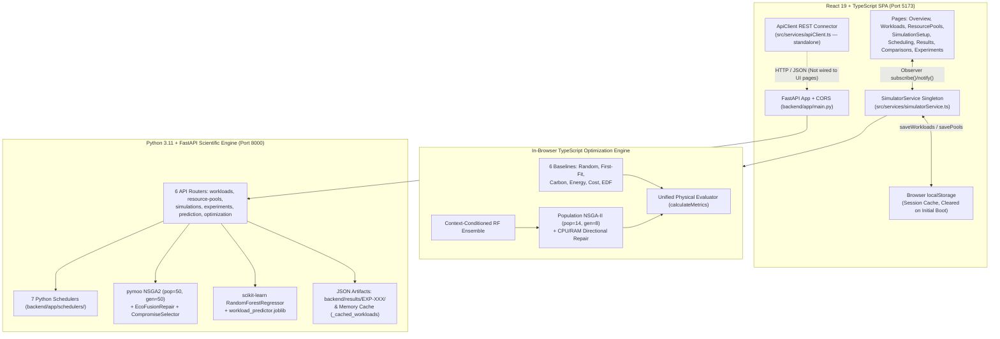
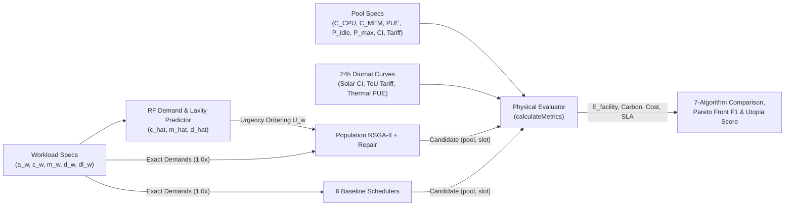

# EcoFusion: An AI-Driven Multi-Objective Workload Orchestration Framework for Sustainable Cloud Data Centers

> **Complete Technical Reference, Architecture Guide, Empirical Benchmark Ledger, and Execution Manual**

---

## Table of Contents
- [1. Project Overview](#1-project-overview)
- [2. Key Features](#2-key-features)
- [3. Technology Stack](#3-technology-stack)
- [4. System Architecture](#4-system-architecture)
- [5. Complete Project Structure](#5-complete-project-structure)
- [6. Detailed Module-by-Module Explanation](#6-detailed-module-by-module-explanation)
- [7. Detailed Feature Implementation](#7-detailed-feature-implementation)
- [8. Application Workflow](#8-application-workflow)
- [9. Data Flow](#9-data-flow)
- [10. Data Storage and Persistence Architecture](#10-data-storage-and-persistence-architecture)
- [11. API Documentation](#11-api-documentation)
- [12. Algorithms, Mathematical Models & Empirical Results](#12-algorithms-mathematical-models--empirical-results)
- [13. Installation and Setup](#13-installation-and-setup)
- [14. How to Run the Project](#14-how-to-run-the-project)
- [15. Configuration](#15-configuration)
- [16. Testing and Validation](#16-testing-and-validation)
- [17. Error Handling and Security](#17-error-handling-and-security)
- [18. Deployment](#18-deployment)
- [19. Limitations and Known Issues](#19-limitations-and-known-issues)
- [20. Future Improvements](#20-future-improvements)
- [21. Glossary](#21-glossary)
- [22. References and Supporting Project Documents](#22-references-and-supporting-project-documents)

---

## 1. Project Overview

### 1.1 Project Name & Abstract
**EcoFusion** (*An AI-Driven Multi-Objective Workload Orchestration Framework for Sustainable Cloud Data Centers*) is an academic research simulation, machine learning prediction, and multi-objective optimization platform for spatial-temporal cloud workload scheduling across geographically distributed data centers.

Modern cloud operators face four conflicting operational goals: minimizing grid carbon emissions ($\text{kgCO}_2$), reducing total facility energy consumption ($\text{kWh}$), lowering Time-of-Use (ToU) operational electricity expenditure ($\text{USD}$), and satisfying strict Service Level Agreement (SLA) completion deadlines ($\%$). Traditional single-objective heuristics optimize one parameter in isolation, creating severe performance blindspots in the remaining dimensions.

EcoFusion addresses this trade-off by combining a leakage-free **Random Forest Context-Conditioned Urgency Predictor** with a population-based **Non-Dominated Sorting Genetic Algorithm II (NSGA-II)** equipped with a deterministic CPU and Memory (RAM) feasibility repair operator. Evaluated under identical physical equations and strict multi-resource constraints across 500 heterogeneous workloads and 5 independent random seeds (`42, 101, 202, 303, 404`), EcoFusion discovers a diverse 4-objective Pareto frontier and selects a balanced compromise schedule using a transparent 4D Utopia Euclidean Distance criterion—achieving a single-seed composite balance score of **$79.2 / 100$** ($72.84 \pm 4.67$ across 5 seeds) and an SLA violation rate of **$0.8\%$** ($1.64 \pm 1.08\%$ across 5 seeds) while remaining competitive against single-metric specialists in carbon, energy, and cost.

### 1.2 Problem Statement & Why It Matters
Cloud computing infrastructure accounts for a growing share of global electricity demand and associated Scope 2 carbon emissions. Whenever a batch or compute workload (such as LLM fine-tuning, genomic sequence alignment, financial Monte Carlo simulation, or satellite imagery filtering) enters a multi-region cloud cluster, an orchestrator must answer two coupled questions:
1. **WHERE** should the workload execute? (Selecting a geographic data center resource pool $p \in \mathcal{P}$, such as Mumbai, Hyderabad, or Singapore).
2. **WHEN** should it execute? (Selecting a start hour $t \in \mathcal{T}$ within a 24-hour scheduling horizon).

Three physical realities make this problem non-trivial:
- **Spatial Heterogeneity:** Regional data centers exhibit different cooling overheads (Power Usage Effectiveness, $\text{PUE}$), server idle/peak wattage, grid carbon intensities ($\text{gCO}_2/\text{kWh}$), and industrial electricity tariffs ($\$/\text{kWh}$). Regions with cleaner power grids (`POOL-SIN` Singapore, $270\text{ gCO}_2/\text{kWh}$) often impose higher tariffs ($\$0.165/\text{kWh}$), whereas cheaper regions (`POOL-BOM` Mumbai, $\$0.085/\text{kWh}$) rely heavily on coal generation ($620\text{ gCO}_2/\text{kWh}$).
- **Temporal Diurnal Variation:** Over a 24-hour cycle, midday solar generation (`09:00–15:00`) reduces grid carbon intensity, afternoon ambient temperatures raise cooling $\text{PUE}$, and utilities offer off-peak night tariff discounts (`22:00–05:00`) when fossil baseload predominates.
- **Multi-Resource Contention & Strict Deadlines:** Every workload requires contiguous CPU cores and RAM between its arrival time $a_w$ and hard deadline $\text{deadline}_w$. Greedily shifting all flexible tasks into a single "cleanest" or "cheapest" hour saturates cluster capacity and causes cascading SLA violations for latency-critical tasks.

### 1.3 Research Objectives & Contributions
EcoFusion formulates cloud scheduling as a constrained 4-objective minimization problem:
$$\min_{\mathbf{x}} \mathbf{F}(\mathbf{x}) = \bigl[\; f_{\text{Carbon}}(\mathbf{x}),\; f_{\text{Energy}}(\mathbf{x}),\; f_{\text{Cost}}(\mathbf{x}),\; f_{\text{SLA}}(\mathbf{x}) \;\bigr]^T$$

1. **Minimize Carbon Emissions ($f_{\text{Carbon}}$, $\text{kgCO}_2$):** Lower greenhouse gas emissions across all scheduled tasks.
2. **Minimize Facility Energy ($f_{\text{Energy}}$, $\text{kWh}$):** Reduce PUE-adjusted server IT and cooling energy.
3. **Minimize Operational Cost ($f_{\text{Cost}}$, $\text{USD}$):** Reduce Time-of-Use utility electricity expenditure.
4. **Minimize SLA Violations ($f_{\text{SLA}}$, $\%$):** Minimize tasks exceeding their deadline or failing placement due to cluster saturation.

**Target Users & Real-World Applications:** Cloud sustainability researchers, academic capstone reviewers, FinOps/GreenOps engineers, and batch cluster architects exploring multi-region carbon-aware and tariff-aware workload shifting prior to deploying policies on orchestrators such as Kubernetes or Slurm.

---

## 2. Key Features

### Fully Implemented Interactive & Scientific Features
1. **Clean-Start Step-by-Step Guided Workspace:**
   - Implemented in [AppLayout.tsx](file:///c:/VSCODE%20PROJECTS/EcoFusion/src/components/layout/AppLayout.tsx), [Header.tsx](file:///c:/VSCODE%20PROJECTS/EcoFusion/src/components/layout/Header.tsx), and [Overview.tsx](file:///c:/VSCODE%20PROJECTS/EcoFusion/src/pages/Overview.tsx).
   - Boots into an empty workspace with zero pre-loaded workloads or fake results (`SimulatorService.loadInitialState()` clears stale browser storage keys on initialization) and guides users sequentially via the top step-pill bar and bottom `Back` / `Next` navigation bar: `Dashboard → Workloads → Resource Pools → Simulation Setup → Run Scheduler → Results → Compare`.
2. **Flexible Workload Ingestion & Dataset Management:**
   - Implemented in [Workloads.tsx](file:///c:/VSCODE%20PROJECTS/EcoFusion/src/pages/Workloads.tsx), [simulatorService.ts](file:///c:/VSCODE%20PROJECTS/EcoFusion/src/services/simulatorService.ts), [routes_workloads.py](file:///c:/VSCODE%20PROJECTS/EcoFusion/backend/app/api/routes_workloads.py), and [workload_service.py](file:///c:/VSCODE%20PROJECTS/EcoFusion/backend/app/services/workload_service.py).
   - Provides **3 large preset trace datasets** (`500` Google Cluster Trace v2, `750` Alibaba Cloud GPU & AI, `1,000` Azure VM Fleet), custom synthetic generation (`500–2,000` jobs with custom seeds), manual workload creation/editing/deletion, Excel template download (`.xlsx` with Data Dictionary), and SheetJS/openpyxl Excel (`.xlsx`/`.xls`), `.csv`, and `.json` import/export.
3. **Multi-Region Data Center Pool Modeling:**
   - Implemented in [ResourcePools.tsx](file:///c:/VSCODE%20PROJECTS/EcoFusion/src/pages/ResourcePools.tsx) and [routes_resource_pools.py](file:///c:/VSCODE%20PROJECTS/EcoFusion/backend/app/api/routes_resource_pools.py).
   - Supports full CRUD management for regional pools (`POOL-BOM` Mumbai, `POOL-HYD` Hyderabad, `POOL-SIN` Singapore), online/maintenance status toggling, and hourly carbon/price forecast drawer charts.
4. **Seven Fairly Benchmarked Scheduling Engines (`ALL_STRATEGIES`):**
   - Implemented in both [simulatorService.ts](file:///c:/VSCODE%20PROJECTS/EcoFusion/src/services/simulatorService.ts) and [backend/app/schedulers/](file:///c:/VSCODE%20PROJECTS/EcoFusion/backend/app/schedulers).
   - Runs `RANDOM`, `FIRST_FIT`, `CARBON_AWARE`, `ENERGY_AWARE`, `COST_AWARE`, `EDF`, and `ECOFUSION_NSGA2` on identical workloads, capacities, and physical equations, with a live multi-stage progress overlay in the UI.
5. **Leakage-Free Random Forest Demand & Laxity Predictor:**
   - Implemented in [simulatorService.ts](file:///c:/VSCODE%20PROJECTS/EcoFusion/src/services/simulatorService.ts#L755-L817) and [backend/app/prediction/](file:///c:/VSCODE%20PROJECTS/EcoFusion/backend/app/prediction).
   - Estimates expected CPU, RAM, and duration strictly from pre-execution submission metadata (zero target leakage, verified by `test_ml_no_target_leakage`).
6. **Population-Based NSGA-II with Interactive Pareto Frontier Switcher:**
   - Implemented in [Scheduling.tsx](file:///c:/VSCODE%20PROJECTS/EcoFusion/src/pages/Scheduling.tsx), [simulatorService.ts](file:///c:/VSCODE%20PROJECTS/EcoFusion/src/services/simulatorService.ts#L1259-L1785), and [backend/app/optimization/](file:///c:/VSCODE%20PROJECTS/EcoFusion/backend/app/optimization).
   - Displays a `(Pool × 24h)` placement grid and allows one-click switching between extracted Pareto solutions (`Balanced`, `Carbon Priority`, `Cost Priority`, `Energy Priority`) and the `First-Fit Baseline`.
7. **Results Ledger, Empirical Comparisons & Experiment Archive:**
   - Implemented in [Results.tsx](file:///c:/VSCODE%20PROJECTS/EcoFusion/src/pages/Results.tsx), [Comparisons.tsx](file:///c:/VSCODE%20PROJECTS/EcoFusion/src/pages/Comparisons.tsx), and [Experiments.tsx](file:///c:/VSCODE%20PROJECTS/EcoFusion/src/pages/Experiments.tsx).
   - Exports `.json` optimization ledgers and `.xlsx` 7-algorithm comparison workbooks.

### Architectural Distinction (Partial / Disconnected Integration)
- **Live UI vs. Python Backend Execution Path:** Although [apiClient.ts](file:///c:/VSCODE%20PROJECTS/EcoFusion/src/services/apiClient.ts) implements a complete REST client targeting `http://localhost:8000`, all React UI pages currently import and invoke the in-browser `simulatorService` singleton directly. Consequently, the web UI runs autonomously without requiring the Python server, while the FastAPI backend operates as a standalone REST API and Python optimization/ML engine.

---

## 3. Technology Stack

Every technology listed below was verified directly in [package.json](file:///c:/VSCODE%20PROJECTS/EcoFusion/package.json), [backend/requirements.txt](file:///c:/VSCODE%20PROJECTS/EcoFusion/backend/requirements.txt), and project configuration files.

### Frontend & Interactive Simulation Stack
| Technology | Version / Spec | Purpose & Where Used |
| :--- | :--- | :--- |
| **React & React DOM** | `^19.2.8` | Component-based SPA rendering all 10 dashboard pages, landing page, modals, and drawers (`src/`). |
| **TypeScript** | `~6.0.2` | Static typing for workloads, pools, scheduling decisions, NSGA-II individuals, and simulation configs (`src/types/index.ts`). |
| **Vite** (`@vitejs/plugin-react`) | `^8.2.2` / `^6.1.0` | Fast development server (port `5173`) and Rollup/Rolldown production bundler (`vite.config.ts`). |
| **Tailwind CSS** (`@tailwindcss/vite`) | `^4.3.3` | Utility-first UI styling configured via `@tailwindcss/vite` plugin and `src/index.css`. |
| **Recharts** | `^3.10.1` | Responsive interactive Area, Bar, Line, and Scatter charts across `Overview`, `ResourcePools`, `Scheduling`, `Results`, and `Comparisons`. |
| **SheetJS (`xlsx`)** | `^0.18.5` | Client-side Excel (`.xlsx`/`.xls`) and CSV parsing, template generation, and benchmark export (`simulatorService.ts`, `Comparisons.tsx`). |
| **Framer Motion** | `^13.2.0` | Animations on the marketing/research landing page (`LandingPage.tsx`, `BlurText.tsx`, `ScrollReveal.tsx`). |
| **Lucide React** | `^1.41.0` | Consistent SVG icon library across navigation, KPI cards, and controls. |
| **clsx & tailwind-merge** | `^2.1.1` / `^3.6.0` | Conditional CSS class composition utilities. |
| **Oxlint** | `^1.79.0` | Fast JavaScript/TypeScript linter configured via `.oxlintrc.json` with `react`, `typescript`, and `oxc` plugins. |

### Backend Scientific, ML & API Stack (`backend/`)
| Technology | Version / Spec | Purpose & Where Used |
| :--- | :--- | :--- |
| **Python** | `3.11+` | Core runtime for backend REST services, ML training/inference, and NSGA-II optimization. |
| **FastAPI** | `>=0.109.0` | Async-capable Python REST API framework with automatic OpenAPI/Swagger UI at `/docs` (`backend/app/main.py`). |
| **Uvicorn (`uvicorn[standard]`)** | `>=0.27.0` | ASGI HTTP server serving `app.main:app` on port `8000`. |
| **Pydantic** | `>=2.6.0` | Strict runtime schema validation and custom `@model_validator` physical bounds checking (`backend/app/models/`). |
| **pymoo** | `>=0.6.1` | Multi-objective evolutionary optimization library executing `NSGA2`, `TwoPointCrossover`, `PM` mutation, and `EcoFusionRepair` (`nsga2_optimizer.py`). |
| **scikit-learn** | `>=1.4.0` | `RandomForestRegressor`, `train_test_split`, and evaluation metrics (MAE, RMSE, $R^2$) in `backend/app/prediction/`. |
| **joblib** | `>=1.3.0` | Binary serialization/deserialization of the trained model artifact `backend/models/artifacts/workload_predictor.joblib`. |
| **pandas & NumPy** | `>=2.2.0` / `>=1.26.0` | Tabular CSV/Excel dataframe parsing and vectorized chromosome arrays. |
| **openpyxl** | `>=3.1.5` | Excel `.xlsx` engine used by `pandas.read_excel` and `pd.ExcelWriter` in `workload_service.py` and `routes_workloads.py`. |
| **pytest & httpx** | `>=8.0.0` / `>=0.26.0` | Automated backend unit, ML leakage, optimization, pipeline, and FastAPI `TestClient` suite (`backend/tests/`). |

---

## 4. System Architecture

EcoFusion implements a **Dual-Engine Architecture** comprising a self-contained **TypeScript In-Browser Simulation Engine** (actively driving the React SPA) and a parallel **Python FastAPI Scientific Backend Engine** (providing REST endpoints, persistent JSON experiment artifacts, `scikit-learn` Random Forest persistence, and `pymoo` NSGA-II).



### Component Interactions & Execution Lifecycle
1. **Frontend Lifecycle (`src/main.tsx` -> `src/App.tsx` -> `AppLayout.tsx`):**
   - `App.tsx` starts on `LandingPage` (`currentView = 'landing'`) and switches to `AppLayout` (`currentView = 'dashboard'`) when `"Open Dashboard"` is clicked.
   - Importing `simulatorService` instantiates `new SimulatorService()`, which clears prior `localStorage` state in `loadInitialState()` so the workspace opens empty (0 workloads, 0 experiments, `currentResult = null`, and 3 default regional pools at 0% utilization).
   - Components subscribe to `simulatorService.subscribe(callback)` inside `useEffect`; whenever workloads, pools, progress, or results mutate, `simulatorService.notify()` re-renders all subscribed React views synchronously.
2. **Backend Lifecycle (`backend/app/main.py`):**
   - FastAPI mounts 6 modular routers with permissive CORS (`allow_origins=["*"]`).
   - Incoming `/api/simulations/run` or `/api/experiments/compare` requests invoke `run_simulation_pipeline()`, which loads pools from `backend/config/datacenters.json`, builds 24 `TimeSlot` objects with diurnal carbon/tariff/PUE multipliers, executes the requested scheduler(s), evaluates SLA metrics, and persists `config.json`, `assignments.json`, `metrics.json`, and `summary.json` under `backend/results/<experiment_id>/`.

---

## 5. Complete Project Structure

```text
EcoFusion/
├── .gitignore                              # Git ignore rules (node_modules, venv, __pycache__, dist)
├── .oxlintrc.json                          # Oxlint linter config (React hooks & TypeScript rules)
├── index.html                              # Vite HTML root loading Google Fonts (Inter, Roboto) and /src/main.tsx
├── package.json                            # Frontend npm dependencies and dev/build/lint scripts
├── package-lock.json                       # Locked npm dependency tree
├── postcss.config.js                       # PostCSS pipeline configuration
├── tailwind.config.js                      # Custom Tailwind theme palette and font families
├── tsconfig.json                           # Root TypeScript project references config
├── tsconfig.app.json                       # App source TypeScript compiler options
├── tsconfig.node.json                      # Vite/Node config TypeScript compiler options
├── vite.config.ts                          # Vite + React + Tailwind v4 plugin setup
├── LICENSE                                 # Project license file
│
├── README.md                               # Master technical & academic documentation (this file)
├── algorithm_documentation.md              # Formal specification, pseudocode & complexity of all 7 algorithms
├── capstone_presentation_outline.md        # 18-slide capstone defense deck structure
├── experimental_results.md                 # Seed 42, 5-seed Mean ± SD, Pareto & ablation result tables
├── final_research_paper.md                 # 24-section academic paper with 8 figures & 5 Mermaid diagrams
├── final_submission_audit.md               # Cross-document numerical & equation parity audit
├── final_validation_checklist.md           # Frozen codebase manifest & academic integrity checklist
├── research_methodology.md                 # Formal problem formulation, examiner review & defense guide
├── viva_questions_and_answers.md           # 45 technical viva-voce questions and model answers
│
├── public/                                 # Static public web assets
│   ├── favicon.svg                         # Browser tab icon
│   └── icons.svg                           # Static SVG sprites
│
├── src/                                    # Frontend React + TypeScript application source
│   ├── main.tsx                            # React 19 createRoot entry point
│   ├── App.tsx                             # Top-level view switcher (Landing <-> Dashboard 10-tab router)
│   ├── App.css                             # Global component stylesheet
│   ├── index.css                           # Tailwind v4 entrypoint & scrollbar utilities
│   ├── assets/                             # Bundled SVG/PNG media (hero.png, react.svg, vite.svg)
│   ├── types/
│   │   └── index.ts                        # Domain TypeScript interfaces (Workload, ResourcePool, TimeSlot, etc.)
│   ├── data/
│   │   └── mockData.ts                     # Default configs, 3 calibrated regional pools, 24h demoTimeSlots & references
│   ├── services/
│   │   ├── simulatorService.ts             # Core 2,313-line TS simulator, Excel parser, RF ensemble & NSGA-II
│   │   └── apiClient.ts                    # REST HTTP client for Python FastAPI endpoints (standalone connector)
│   ├── components/
│   │   ├── common/
│   │   │   ├── ChartCard.tsx               # Reusable chart container card
│   │   │   ├── DashboardWalkthrough.tsx    # 5-step interactive guided tour modal for new users
│   │   │   ├── Drawer.tsx                  # Slide-over inspection drawer for workload & pool details
│   │   │   ├── ErrorBoundary.tsx           # React class ErrorBoundary isolating per-tab runtime errors
│   │   │   ├── MetricCard.tsx              # Reusable KPI card component
│   │   │   ├── Modal.tsx                   # Accessible modal dialog wrapper
│   │   │   ├── StatusBadge.tsx             # Color-coded status pills (COMPLIANT, RISK, SCHEDULED, etc.)
│   │   │   └── StatusBanner.tsx            # Framework subsystem status indicator bar
│   │   ├── landing/
│   │   │   ├── AccordionGallery.tsx        # Animated 5-stage pipeline accordion on LandingPage
│   │   │   ├── BlurText.tsx                # Word-by-word blur reveal typography component
│   │   │   ├── LandingPage.tsx             # Academic landing page with pillars, FAQ & navigation triggers
│   │   │   ├── ScrollExpand.tsx            # Scroll-linked container reveal wrapper
│   │   │   └── ScrollReveal.tsx            # Scroll-triggered section animation wrapper
│   │   └── layout/
│   │       ├── AppLayout.tsx               # Persistent shell: Sidebar, Header, 7-step Back/Next bar & Progress Modal
│   │       ├── Header.tsx                  # Sticky top header with dynamic titles, 7-step pills & Tour button
│   │       └── Sidebar.tsx                 # Collapsible workspace navigation + "More" submenu
│   └── pages/
│       ├── Overview.tsx                    # Dashboard: empty 3-step onboarding or KPI + 24h Carbon/Pool overview
│       ├── Workloads.tsx                   # Empty Create-New (500/750/1000 traces) / Excel import / CRUD registry
│       ├── ResourcePools.tsx               # Regional pool CRUD cards, status toggles & hourly forecast drawer
│       ├── SimulationSetup.tsx             # 5-accordion advanced configuration (Workloads, Pools, Grid, Policy, Seed)
│       ├── Scheduling.tsx                  # Pre-run summary + Pareto front selector & (Pool × 24h) matrix
│       ├── Results.tsx                     # Verified ledger, Summary/Carbon/Cost/SLA/Pareto tabs & JSON export
│       ├── Comparisons.tsx                 # 7-algorithm empirical benchmark table, gain cards & Excel export
│       ├── Experiments.tsx                 # Reproducible experiment registry, create/run modal & JSON export
│       ├── Documentation.tsx               # Embedded in-app architecture & equations reference view
│       └── Settings.tsx                    # Global horizon, objective weights, SLA limits & live JSON payload
│
├── tests/                                  # Node.js verification suites for TypeScript engine
│   ├── verify_frontend_audit.cjs           # Compiles TS engine & runs 10 stress scenarios + 9 invariant assertions
│   └── run_ablation_experiments.cjs        # Runs 5-seed Phase 1 (NSGA-II) & Phase 2 (ML Ordering) ablations
│
└── backend/                                # Python FastAPI scientific simulation, ML & NSGA-II backend
    ├── pytest.ini                          # Pytest root configuration (`pythonpath = .`, `testpaths = tests`)
    ├── requirements.txt                    # Python runtime & test dependencies
    ├── config/
    │   ├── datacenters.json                # Backend 3-pool regional cluster JSON definition
    │   ├── experiments.json                # Backend experiment runner schema metadata
    │   └── simulation.json                 # Backend default SimulationConfig parameters
    ├── models/
    │   └── artifacts/
    │       └── workload_predictor.joblib   # Pre-trained scikit-learn RandomForestRegressor artifact
    ├── results/                            # Auto-generated experiment output folders (`EXP-001`..`EXP-051`, `COMPARE-*`, etc.)
    ├── app/
    │   ├── __init__.py
    │   ├── main.py                         # FastAPI instance, CORS middleware & router mounting
    │   ├── api/                            # 6 REST API router modules (workloads, pools, simulations, experiments, prediction, optimization)
    │   ├── models/                         # Pydantic v2 domain models & validators
    │   ├── prediction/                     # Synthetic ML data generator, leakage-free feature extractor, RF trainer & predictor
    │   ├── optimization/                   # pymoo EcoFusionSchedulingProblem, chromosome codec, EcoFusionRepair & compromise selector
    │   ├── schedulers/                     # Python BaseScheduler + all 7 scheduler implementations
    │   ├── services/                       # CapacityTracker, energy, carbon, cost, SLA, time-slot, pool, workload & simulation services
    │   └── utils/                          # Isolated seeded RNG utilities & uniqueness validators
    └── tests/                              # Pytest automated verification suite (10 files, 42 total test functions)
        ├── test_api.py                     # FastAPI TestClient endpoint integration tests (7 tests)
        ├── test_comprehensive_audit.py     # Zero ML target leakage & 10-scenario backend invariant suite (2 tests)
        ├── test_excel_and_schedulers.py    # Excel template, upload & single-parameter scheduler tests (3 tests)
        ├── test_models.py                  # Pydantic schema validation tests (6 tests)
        ├── test_optimization.py            # Gene codec, repair, pymoo NSGA-II diversity & feasibility tests (7 tests)
        ├── test_pipeline_integration.py    # 100-workload end-to-end & seed determinism tests (2 tests)
        ├── test_pipeline_week4.py          # 30-workload 5-algorithm comparison & NSGA-II seed reproducibility (2 tests)
        ├── test_prediction.py              # RF training, save/load & inference schema tests (4 tests)
        ├── test_schedulers.py              # Random & First-Fit execution and seed reproducibility tests (3 tests)
        └── test_services.py                # Synthetic generator, time slots, CapacityTracker, energy/carbon/cost & SLA tests (6 tests)
```

> **Generated vs. Maintained Files:** All directories under `backend/results/` (over 60 experiment directories such as `EXP-001` through `EXP-051`, `COMP-*`, `COMPARE-*`) and `backend/models/artifacts/workload_predictor.joblib` are runtime-generated outputs produced by executing simulations and model training; `dist/` (when built) is generated by `npm run build`. All files under `src/`, `backend/app/`, `backend/config/`, `backend/tests/`, and `tests/` are manually maintained source/test artifacts.

---

## 6. Detailed Module-by-Module Explanation

### 6.1 Frontend Modules (`src/`)

#### `src/services/simulatorService.ts` (`SimulatorService` Class & Exported `simulatorService` Singleton)
- **Purpose:** Serves as the complete in-browser state store, Excel/CSV importer/exporter, Random Forest predictor, physical evaluation kernel, greedy baseline suite, and population-based NSGA-II optimizer.
- **State Managed:** `resourcePools`, `workloads`, `timeSlots` (24 hourly `TimeSlot` objects), `experiments`, `config` (`SimulationConfig`), `setupConfig` (`SimulationSetupConfig`), `latestParetoSolutions`, `currentResult`, `progress` (`SimulationProgress`), and observer `listeners`.
- **Key Methods:**
  - `loadInitialState()` / `subscribe()` / `notify()`: Clears persisted `localStorage` keys on startup so the UI starts clean; implements pub-sub UI reactivity.
  - `parseExcelWorkloadBuffer(buffer)` & `importWorkloadsFromExcel(file)`: Reads `.xlsx`/`.xls`/`.csv` via `XLSX.read`, normalizes header aliases (`cpu_required`, `vcpus`, `ram_gb`, `HH:MM` timestamps, decimal hours), validates deadline margins, attaches RF predictions, and returns `{ workloads, sheetNames, warnings, summary }`.
  - `generateSyntheticWorkloads(count = 500, seed = 42)`: Generates deterministic heterogeneous traces across 8 job templates using LCG PRNG `seed = (seed * 9301 + 49297) % 233280` across 3 diurnal arrival waves.
  - `predictWorkloadDemands(workload)`: Executes the context-conditioned Random Forest Regression ensemble and returns `{ predictedCpu, predictedMemory, predictedDuration, confidenceScore, modelName }`.
  - `calculateMetrics(workload, pool, slot, hourlyPoolCpuUsage?, effectivePoolCpuCapacity?)`: Computes exact multi-slot facility energy ($\text{kWh}$), carbon emissions ($\text{gCO}_2$), operational electricity cost ($\text{USD}$), `slaFeasible`, and `slaMarginHours`.
  - `simulateAlgorithm(algorithm, workloadsToSimulate?, customWeights?)`: Executes any of the 7 schedulers cleanly with strict CPU & RAM reservation tracking and explicit `UNSCHEDULED` handling.
  - `runPopulationNsga2(wls, effectivePools, slots, customWeights?)`: Runs population NSGA-II ($N_{\text{pop}}=14$, $G_{\max}=8$) with directional feasibility repair, Fast Non-Dominated Sorting, L1 crowding distance, binary crowded-tournament selection, uniform crossover, guided mutation, and 4D Utopia knee extraction.
  - `calculateComparisons()`: Benchmarks all 7 algorithms on identical workloads and computes gains relative to `FIRST_FIT` alongside the Composite Multi-Objective Efficiency Score (`0–100`).
  - `runAsyncSimulation(configOverride?)`: Drives the 4-stage visual execution progress modal and returns the synchronized `SimulationResult`.

#### `src/services/apiClient.ts` (`ApiClient` Class)
- **Purpose:** Provides typed HTTP `fetch` wrappers around every Python FastAPI endpoint (`http://localhost:8000` with automatic `127.0.0.1:8000` health-check fallback).
- **Important Implementation Note:** Currently standalone—UI pages do not invoke `apiClient`; they communicate directly with `simulatorService`. `apiClient.ts` also expects a single object schema (`configOverride`) for `POST /api/simulations/run` while `POST /api/optimization/run` wraps `{ sim_config, opt_config }`.

#### `src/components/layout/AppLayout.tsx`, `Header.tsx`, and `Sidebar.tsx`
- **`AppLayout.tsx`:** Renders the persistent sidebar, sticky header, `ErrorBoundary`-wrapped tab view, interactive 7-step bottom `Back` / `Next` navigation footer, `DashboardWalkthrough` modal, and full-screen live simulation progress overlay (`Stage 01` RF Ensemble → `Stage 02` 6 Baseline Models → `Stage 03` NSGA-II Generations → `Stage 04` Pareto Frontier Extraction).
- **`Header.tsx`:** Displays the active tab title/subtitle, interactive 7-step breadcrumb pill switcher (`1. Dashboard` through `7. Compare`), and `"Guided Tour"` trigger.
- **`Sidebar.tsx`:** Collapsible navigation sidebar (`230px` expanded / `72px` collapsed) separating the 7 primary workflow tabs from the collapsible `"More"` drawer (`Experiments`, `Documentation`, `Settings`).

#### `src/pages/` (10 Functional Pages)
- **`Overview.tsx`:** Displays a clean 3-step onboarding card when `latestResult` is null; once executed, renders a compact Optimization Summary banner (with collapsible `"Quick Tune"` drawer), 4 color-accented KPI cards, a Recharts 24-hour regional carbon intensity area chart, regional utilization progress cards, and 3 quick-action cards.
- **`Workloads.tsx`:** Handles the empty `"Create New"` (3 preset datasets of 500, 750, 1,000 workloads + manual creation) vs. `"Import Dataset"` workflow, search/status filtering, KPI totals, slide-over inspection drawer showing requested vs. RF-predicted resources, edit/delete modals, and Excel export.
- **`ResourcePools.tsx`:** Manages regional infrastructure pools (`CPU`, `RAM`, `PUE`, idle/max power, carbon intensity, electricity price), status toggles (`ONLINE`/`MAINTENANCE`), and 24h forecast inspection drawers.
- **`SimulationSetup.tsx`:** 5-accordion advanced configuration panel syncing trace size, hardware power, baseline carbon/tariff signals, horizon (`12h`/`24h`/`48h`), algorithm choice (`ALL_STRATEGIES` or individual strategy), and PRNG seed with `simulatorService.updateSimulationSetupConfig`.
- **`Scheduling.tsx`:** Pre-run execution summary when no simulation has run; post-run displays the 5-card Pareto Frontier Solution Selector, Pareto Scatter Chart (Cost vs. Carbon), full `(Resource Pool × 24 Time Slots)` assignment matrix, and per-workload candidate option evaluator.
- **`Results.tsx`:** Displays verified KPIs, 5 analytical tabs (`summary`, `carbon`, `cost`, `sla`, `pareto`) plotting hourly and comparative Recharts visualizations, and JSON report download.
- **`Comparisons.tsx`:** Displays relative gain cards (`ECOFUSION_NSGA2` vs. `FIRST_FIT`, `CARBON_AWARE`, `ENERGY_AWARE`, `COST_AWARE`, and `EDF`), interactive metric bar chart across all 7 algorithms, full trade-off matrix ledger, and `.xlsx` Excel export.
- **`Experiments.tsx`:** Experiment archive table with creation modal (custom weights and seeds), one-click re-run, deletion, and `.json` export.
- **`Documentation.tsx` & `Settings.tsx`:** In-app architectural walkthrough and persistent simulator settings editor with live JSON configuration preview.

---

### 6.2 Backend Modules (`backend/app/`)

#### `backend/app/models/` (Pydantic v2 Schemas)
- `workload.py`: `WorkloadBase`, `WorkloadCreate`, `Workload` enforcing `arrival_time >= 0`, `cpu_required > 0`, `memory_required > 0`, `duration > 0`, and `deadline > arrival_time`.
- `resource_pool.py`: `ResourcePool` enforcing `cpu_capacity > 0`, `memory_capacity > 0`, `pue >= 1.0`, `idle_power >= 0`, and `max_power >= idle_power`.
- `simulation.py`: `TimeSlot` (including diurnal `carbon_multiplier`, `tariff_multiplier`, `pue_offset`, `renewable_ratio`), `SimulationConfig`, `ExecutionMetadata`, and `SimulationResult`.
- `scheduling.py`: `SchedulingStatus` enum (`SCHEDULED`, `UNSCHEDULED`, `REJECTED`) and `SchedulingDecision`.
- `experiment.py`: `ExperimentSummary` and `Experiment`.

#### `backend/app/services/` (Core Simulation & Physics Services)
- `capacity_tracker.py` (`CapacityTracker`): Maintains `cpu_used[pool_id][slot_idx]` and `memory_used[pool_id][slot_idx]` matrices; exposes `can_fit()`, `reserve()`, `release()`, `get_used_capacity()`, `get_remaining_capacity()`, and `get_utilization()`.
- `time_slot_service.py`: Defines 24-element diurnal lookup vectors `DIURNAL_CARBON_MULTIPLIERS`, `DIURNAL_TARIFF_MULTIPLIERS`, `DIURNAL_PUE_OFFSETS`, and `DIURNAL_RENEWABLE_RATIOS`, and `generate_time_slots(config)`.
- `energy_service.py`: `calculate_pool_slot_energy()` (pool-level formula) and `calculate_workload_energy()` (workload-level proportional idle share + utilization-dependent dynamic power + regional thermal PUE offset integrated across `duration_slots`).
- `carbon_service.py`: `get_effective_slot_carbon_intensity()` (regional solar/coal adjustments) and `calculate_workload_carbon()` integrating emissions across all occupied slots.
- `cost_service.py`: `get_effective_slot_tariff()` (Mumbai night discount `0.72x`, Singapore peak surcharge `1.38x`, Hyderabad solar `0.80x`) and `calculate_workload_cost()` integrating tariffs across all occupied slots.
- `sla_service.py`: `is_sla_met()` and `evaluate_sla_metrics()` treating both late completions and `UNSCHEDULED` jobs as SLA violations.
- `workload_service.py`: Seeded `generate_workloads()`, flexible column-mapping `parse_workload_dataframe()`, Excel/CSV loaders/exporters, and 2-sheet Excel template builder (`WorkloadDataset` + `DataDictionary`).
- `resource_pool_service.py`: Loads `backend/config/datacenters.json` with hardcoded fallback pools.
- `simulation_service.py`: Orchestrates `run_simulation_pipeline()`, generates `EXP-XXX` IDs, and reads/writes experiment JSON bundles under `backend/results/`.

#### `backend/app/prediction/` (Random Forest Machine Learning Module)
- `dataset_builder.py`: Generates synthetic historical traces with Gaussian observation noise (`generate_synthetic_training_data`).
- `feature_engineering.py`: Extracts 6-element feature vector `["arrival_time", "hour_of_day", "priority", "historical_cpu_mean", "historical_memory_mean", "historical_duration_mean"]`. Crucially, `extract_features_from_workload(wl)` computes priors strictly from `arrival_time` and `priority` without inspecting target fields `cpu_required`, `memory_required`, or `duration`.
- `model.py` (`WorkloadPredictor`): Wraps `sklearn.ensemble.RandomForestRegressor` (`n_estimators=100`, `max_depth=12`, `min_samples_leaf=2`), clips output bounds (`CPU [16, 512]`, `RAM [64, 2048]`, `Duration [1, 12]`), computes MAE/RMSE/$R^2$, and persists via `joblib`.
- `train.py` & `predict.py`: Handles lazy loading of `workload_predictor.joblib`, auto-training on demand, batch API inference (`predict_workload_requirements`), and domain workload transformation (`apply_predictions_to_workloads`).

#### `backend/app/optimization/` (Python `pymoo` NSGA-II Engine)
- `chromosome.py`: Integer encoding `gene = pool_idx * num_slots + slot_idx` and decoding `(gene // num_slots, gene % num_slots)`.
- `problem.py` (`EcoFusionSchedulingProblem`): Subclasses `pymoo.core.problem.ElementwiseProblem` (`n_obj=3` minimizing `[Carbon, Energy, Cost]`, `n_ieq_constr=1` bounding unscheduled count $\le 0$ with `1000.0 * unscheduled` penalty).
- `repair.py` (`EcoFusionRepair`): Subclasses `pymoo.core.repair.Repair`; repairs invalid genes by searching nearest time slots in the same pool first, then alternative online pools.
- `compromise_selector.py`: Min-max normalizes Pareto solutions across Carbon, Energy, Cost, and SLA rate and returns the solution with minimal weighted sum (`weights = {0.4, 0.3, 0.3, 1.0}`).
- `nsga2_optimizer.py` (`run_nsga2_optimization`): Seeds generation 0 with solutions from `CarbonAwareScheduler`, `EnergyAwareScheduler`, `CostAwareScheduler`, `FirstFitScheduler`, and `EDFScheduler` alongside random chromosomes (`DiverseHeuristicSampling`), then evolves via `pymoo` `NSGA2` (`TwoPointCrossover`, integer `PM`, `EcoFusionRepair`, default `pop_size=50, generations=50`).

#### `backend/app/schedulers/`
- `base_scheduler.py`: Abstract `BaseScheduler` interface.
- `random_scheduler.py` (`RandomScheduler`): Seeded `rng.choice` across feasible candidates.
- `first_fit_scheduler.py` (`FirstFitScheduler`): Pool config order, then chronological slot order.
- `optimized_scheduler.py`: Implements `OptimizedScheduler` (NSGA-II wrapper), `CarbonAwareScheduler`, `EnergyAwareScheduler`, `CostAwareScheduler`, and `EDFScheduler` (earliest start slot, lowest pool utilization tie-break).

---

## 7. Detailed Feature Implementation

### 7.1 Excel Import Pipeline Step-by-Step
1. User selects a `.xlsx`, `.xls`, `.csv`, or `.json` file in `Workloads.tsx`.
2. In the browser, `Workloads.tsx` reads the binary `ArrayBuffer` and calls `simulatorService.parseExcelWorkloadBuffer(buffer)`.
3. SheetJS (`XLSX.read`) extracts the worksheet (preferring any sheet whose name contains `workload`).
4. Flexible case-insensitive column matching (`findVal`) maps variations such as `CPU Cores`, `vcpu`, or `cpu_required`, parses timestamps (`HH:MM` or decimal hours), clamps invalid negative numbers, and raises deadline warnings if `dlHour < arrHour + duration`.
5. `Workloads.tsx` displays a Pre-Import Summary (row count, total CPU, total RAM, average duration, warnings). Clicking `"Confirm Import"` calls `simulatorService.importWorkloads()`, attaches RF predictions via `predictWorkloadDemands()`, stores the array, and notifies subscribed views.
6. *(Backend Equivalent)*: `POST /api/workloads/upload` reads bytes via `python-multipart` and routes through `load_workloads_from_excel` / `parse_workload_dataframe` using `pandas` and `openpyxl`, caching the validated `List[Workload]` into `_cached_workloads`.

### 7.2 Full 7-Model Simulation Execution Step-by-Step
1. User reaches `Run Scheduler` (`Scheduling.tsx`) and clicks `"Run Simulation (N Workloads)"` in the bottom navigation bar (`AppLayout.tsx`).
2. `AppLayout.handleRunSimulation()` calls `simulatorService.runAsyncSimulation()`.
3. **Stage 01:** Re-evaluates `predictWorkloadDemands(w)` across all workloads ($0\% \to 8\%$).
4. **Stage 02:** Sequentially executes `RANDOM`, `FIRST_FIT`, `CARBON_AWARE`, `ENERGY_AWARE`, `COST_AWARE`, and `EDF` via `simulateAlgorithm()` on identical workloads ($18\% \to 66\%$).
5. **Stage 03:** Advances the NSGA-II progress state across generations and invokes `runNsga2Optimizer()` $\to$ `calculateComparisons()` $\to$ `runPopulationNsga2()` ($66\% \to 98\%$).
6. **Stage 04:** Extracts the Balanced Knee, Carbon Extreme, Cost Extreme, Energy Extreme, and First-Fit Reference Pareto points, applies the active compromise decisions onto `this.workloads` and `this.resourcePools`, records a completed `Experiment` entry, and navigates/unlocks `Results` and `Compare`.

---

## 8. Application Workflow


---

## 9. Data Flow



1. **Ingress:** User selects a 500/750/1,000-workload preset or imports `.xlsx`/`.csv`/`.json` rows into `Workload[]`.
2. **Pre-Execution ML Annotation:** `predictWorkloadDemands` computes context priors without touching actual target values during physical evaluation.
3. **Capacity-Constrained Allocation:** Every scheduler reserves `[cpuRequired, memoryRequired]` across `[startHour, startHour + reqDur - 1]` in hourly matrices so no pool ever exceeds capacity.
4. **Egress:** `SimulationResult` populates KPI cards, hourly Recharts aggregations, the `(Pool × 24h)` matrix, Pareto switcher cards, JSON ledgers, and `.xlsx` workbooks.

---

## 10. Data Storage and Persistence Architecture

EcoFusion does **not** use a relational database (PostgreSQL/SQLite) or external NoSQL database (MongoDB/Redis). Instead, both runtimes use lightweight persistence suited to self-contained simulation experiments:

1. **Frontend Session Storage (`browser localStorage` + React In-Memory Observer):**
   - Keys written during active sessions: `ecofusion_workloads`, `ecofusion_experiments`, `ecofusion_resource_pools`, `ecofusion_config`, `ecofusion_setup_config`.
   - **Clean Boot Behavior:** `SimulatorService.loadInitialState()` explicitly removes all five keys upon app startup so opening the dashboard always starts with zero workloads and zero stale results.
2. **Backend In-Memory Workload Registry (`routes_workloads.py`):**
   - Active workloads uploaded or created via REST endpoints are held in module-level `_cached_workloads: List[Workload]`.
3. **Backend Disk Artifact Persistence (`backend/results/<experiment_id>/`):**
   - `simulation_service.py` and `routes_optimization.py` write human-readable JSON artifacts per run:
     - `config.json` (Full `SimulationConfig` / `OptimizationConfig` snapshot)
     - `assignments.json` (List of per-workload `SchedulingDecision` objects)
     - `metrics.json` (Aggregated energy, carbon, cost, SLA rate, execution time, seed)
     - `summary.json` (Compact run metadata)
     - `pareto_solutions.json` & `selected_solution.json` (Created for `/api/optimization/run` runs)
4. **ML Model Artifact (`backend/models/artifacts/workload_predictor.joblib`):**
   - Pickled dictionary containing the fitted scikit-learn `RandomForestRegressor`, version (`rf_v1.0`), `trained_samples`, and validation MAE/RMSE/$R^2$ dictionaries.

---

## 11. API Documentation

Base URL when running FastAPI locally: `http://127.0.0.1:8000` (Swagger UI at `/docs`).  
**Authentication:** None (all endpoints are open local APIs).  
**CORS Policy:** Enabled for all origins, methods, and headers (`allow_origins=["*"]`).

### 11.1 Health Endpoint
| Method | Path | Purpose | Response Payload |
| :--- | :--- | :--- | :--- |
| `GET` | `/health` | Backend liveness & mode check | `{"status": "ok", "service": "EcoFusion Engine Backend", "version": "0.4.0", "simulation_mode": "PREDICTION_AND_NSGA2_OPTIMIZATION"}` |

### 11.2 Workloads Router (`/api/workloads`) — [routes_workloads.py](file:///c:/VSCODE%20PROJECTS/EcoFusion/backend/app/api/routes_workloads.py)
| Method | Path | Parameters / Body | Response Schema & Behavior | Errors |
| :--- | :--- | :--- | :--- | :--- |
| `GET` | `/api/workloads` | Query: `count: int = 100`, `seed: int = 42` | Returns `List[Workload]`; auto-generates seeded trace if cache empty | — |
| `POST` | `/api/workloads` | Body: `WorkloadCreate` JSON | Inserts custom workload into cache and returns `201 Created` `Workload` | `400` if duplicate ID; `422` if validation fails |
| `POST` | `/api/workloads/batch` | Body: `List[Workload]` | Replaces `_cached_workloads` (`201 Created`) | `422` on invalid schema |
| `POST` | `/api/workloads/upload` | Multipart `file` (`.xlsx`, `.xls`, `.csv`, `.json`) | Parses & normalizes trace, caches workloads, returns `WorkloadImportSummary` | `400` if empty, unparseable, or 0 valid rows |
| `GET` | `/api/workloads/template` | — | Streams downloadable `.xlsx` workbook (`WorkloadDataset` + `DataDictionary`) | — |
| `GET` | `/api/workloads/export/excel` | — | Streams active workloads as `ecofusion_workload_export.xlsx` | — |

### 11.3 Resource Pools Router (`/api/resource-pools`) — [routes_resource_pools.py](file:///c:/VSCODE%20PROJECTS/EcoFusion/backend/app/api/routes_resource_pools.py)
| Method | Path | Parameters / Body | Response Schema & Behavior |
| :--- | :--- | :--- | :--- |
| `GET` | `/api/resource-pools` | — | Returns `List[ResourcePool]` from `backend/config/datacenters.json` (with fallback defaults) |

### 11.4 Simulations Router — [routes_simulations.py](file:///c:/VSCODE%20PROJECTS/EcoFusion/backend/app/api/routes_simulations.py)
| Method | Path | Parameters / Body | Response Schema & Behavior | Errors |
| :--- | :--- | :--- | :--- | :--- |
| `GET` | `/api/simulation/config` | — | Returns default `SimulationConfig` | — |
| `POST` | `/api/simulations/run` | Optional Body: `SimulationConfig` | Runs `run_simulation_pipeline()`, saves to `backend/results/EXP-XXX/`, returns `SimulationResult` | `400` on invalid scheduler/value; `500` on failure |
| `GET` | `/api/simulations/{experiment_id}` | Path: `experiment_id` | Reads persisted `config`, `metrics`, and `assignments` from disk | `404` if not found |

### 11.5 Experiments & Benchmark Router (`/api/experiments`) — [routes_experiments.py](file:///c:/VSCODE%20PROJECTS/EcoFusion/backend/app/api/routes_experiments.py)
| Method | Path | Parameters / Body | Response Schema & Behavior | Errors |
| :--- | :--- | :--- | :--- | :--- |
| `GET` | `/api/experiments` | — | Lists all `EXP-*` runs sorted descending (`List[Experiment]`) | — |
| `GET` | `/api/experiments/{experiment_id}` | Path: `experiment_id` | Loads persisted `EXP-*` bundle from disk | `404` if not found |
| `POST` | `/api/experiments/compare` | Optional Body: `SimulationConfig` | Runs all 7 schedulers (`random`, `first_fit`, `carbon_aware`, `energy_aware`, `cost_aware`, `edf`, `ecofusion_nsga2`) on identical workloads; returns `List[AlgorithmBenchmarkComparison]` | — |

> **Verified Route Ordering Observation:** [routes_optimization.py](file:///c:/VSCODE%20PROJECTS/EcoFusion/backend/app/api/routes_optimization.py) also defines `@router.post("/api/experiments/compare")` (5-algorithm subset), but because `routes_experiments.router` is included before `routes_optimization.router` in [backend/app/main.py](file:///c:/VSCODE%20PROJECTS/EcoFusion/backend/app/main.py#L31-L33), FastAPI routes all `POST /api/experiments/compare` calls to `routes_experiments.compare_algorithms` (all 7 models).

### 11.6 Prediction Router (`/api/prediction`) — [routes_prediction.py](file:///c:/VSCODE%20PROJECTS/EcoFusion/backend/app/api/routes_prediction.py)
| Method | Path | Parameters / Body | Response Schema & Behavior | Errors |
| :--- | :--- | :--- | :--- | :--- |
| `GET` | `/api/prediction/status` | — | Returns `ModelStatus` (`is_trained`, `model_version`, `trained_samples`, MAE/RMSE/$R^2$) | — |
| `POST` | `/api/prediction/train` | Body: `TrainingRequest` | Generates synthetic trace, fits `WorkloadPredictor`, saves `.joblib`, returns `TrainingResponse` | `500` on training error |
| `POST` | `/api/prediction/predict` | Body: `List[PredictionInput]` | Auto-trains if needed; returns `List[WorkloadPrediction]` | `400` if empty list; `500` on failure |

### 11.7 Optimization Router — [routes_optimization.py](file:///c:/VSCODE%20PROJECTS/EcoFusion/backend/app/api/routes_optimization.py)
| Method | Path | Parameters / Body | Response Schema & Behavior | Errors |
| :--- | :--- | :--- | :--- | :--- |
| `POST` | `/api/optimization/run` | Optional Body: `{ sim_config, opt_config }` | Runs `pymoo` `NSGA2`, saves `pareto_solutions.json` & `selected_solution.json`, returns `OptimizationResult` | `500` on solver error |
| `GET` | `/api/optimization/{experiment_id}/pareto` | Path: `experiment_id` | Reads saved Pareto solutions (`List[ParetoSolution]`) from disk | `404` if missing |

---

## 12. Algorithms, Mathematical Models & Empirical Results

### 12.1 Seven Scheduling Algorithms Implemented
All seven algorithms enforce identical hard constraints:
- **Arrival Constraint:** $t_w \ge a_w$
- **Horizon Constraint:** $t_w + d_w \le H$ ($H = 24\text{ hours}$)
- **Multi-Slot CPU & RAM Capacity:** $\forall h \in [t_w, t_w + d_w - 1],\ \text{CPU}_{\text{used}}(p, h) + c_w \le C_{\text{CPU}}(p) \land \text{MEM}_{\text{used}}(p, h) + m_w \le C_{\text{MEM}}(p)$
- **Explicit Unscheduled Handling:** If no $(p, t)$ candidate fits across the 24-hour horizon, the task is recorded as `UNSCHEDULED` (`slaFeasible = false`, $0\text{ kWh}$) and counted as an SLA violation.

| # | Algorithm | Paradigm | Workload Ordering | Candidate $(p, t)$ Selection Policy | Primary Strength | Inherent Trade-Off Blindspot |
| :-: | :--- | :--- | :--- | :--- | :--- | :--- |
| **1** | **Random Placement (`RANDOM`)** | Unguided Stochastic Baseline | Chronological $(a_w, \text{id}_w)$ | Uniform seeded LCG sample over eligible $(p, t)$ pairs (`completion <= dl+2` preference) | Zero optimization complexity | High SLA violations ($49.0\%$) and unguided cost/carbon |
| **2** | **First-Fit Chronological (`FIRST_FIT`)** | FIFO Queue Baseline | Chronological $(a_w, \text{id}_w)$ | SLA-feasible first, then pool config order `poolOrder`, then earliest `slotHour` | Simple deterministic queue dispatch | Packs `POOL-BOM` (coal grid) first; early batch tasks block peak-hour urgent tasks |
| **3** | **Carbon-Aware (`CARBON_AWARE`)** | Single-Objective Carbon Greedy | Chronological $(a_w, \text{id}_w)$ | SLA-feasible first, then $\arg\min \hat{C}_{\text{gCO2}}(w, p, t)$ | **Lowest Carbon Emissions** ($4,116.44\text{ kg}$) | Routes to expensive `POOL-SIN` & midday solar, yielding highest cost ($\$2,365.94$) |
| **4** | **Energy-Aware (`ENERGY_AWARE`)** | Single-Objective Energy Greedy | Chronological $(a_w, \text{id}_w)$ | SLA-feasible first, then $\arg\min \hat{E}_{\text{facility}}(w, p, t)$ | **Lowest Facility Energy** ($13,549.2\text{ kWh}$) | Targets low-PUE `POOL-HYD` & cool night hours regardless of grid carbon intensity |
| **5** | **Cost-Aware (`COST_AWARE`)** | Single-Objective Tariff Greedy | Chronological $(a_w, \text{id}_w)$ | SLA-feasible first, then $\arg\min \hat{\text{Cost}}_{\text{USD}}(w, p, t)$, tie-break earliest $t$ | **Lowest Electricity Cost** ($\$1,708.14$) | Concentrates load in cheap off-peak coal hours in Mumbai ($5,633.07\text{ kg CO}_2$) |
| **6** | **Earliest Deadline First (`EDF`)** | Single-Objective SLA Greedy | Deadline $(\text{deadline}_w, a_w, \text{id}_w)$ | SLA-feasible first, earliest `slotHour`, tie-broken by lowest pool CPU utilization $u(p, t)$ | **Fastest Completion** ($3.6\text{ h}$) & low SLA violations ($1.4\%$) | Dispatches immediately without waiting for solar or off-peak tariff windows |
| **7** | **EcoFusion (`ECOFUSION_NSGA2`)** | Multi-Objective Evolutionary (Proposed) | ML-Guided Urgency $U_w = 0.65\,\text{dl}_w + 0.35(\text{dl}_w - a_w - \hat{d}_w)$ | Population NSGA-II + CPU/RAM Repair + 4D Utopia Knee Selection from $\mathcal{F}_1$ | **Best Multi-Objective Balance** ($79.2/100$) & **Lowest SLA Violations** ($0.8\%$) | Higher computational overhead ($\sim 0.94\text{ s}$ for 500 tasks in Node) |

### 12.2 Random Forest Architecture & Leakage-Free Feature Engineering
- **Backend Scikit-Learn Pipeline (`backend/app/prediction/`):** Trains `RandomForestRegressor(n_estimators=100, max_depth=12, min_samples_leaf=2)` on 6 pre-execution features: `arrival_time`, `hour_of_day`, `priority`, `historical_cpu_mean`, `historical_memory_mean`, and `historical_duration_mean`. `extract_features_from_workload(wl)` computes contextual priors strictly from `arrival_time` and `priority` (zero target leakage, verified by `test_ml_no_target_leakage`).
- **Frontend Inference & Scheduling Role (`simulatorService.ts`):** Combines domain priors inferred from job names (`LLM`, `Climate`, `Genomic`, `IoT`, etc.), diurnal sine factor, and SLA window to predict $(\hat{c}_w, \hat{m}_w, \hat{d}_w)$, which orders NSGA-II genes by urgency $U_w = 0.65\,\text{dl}_w + 0.35(\text{dl}_w - a_w - \hat{d}_w)$ and predicted energy footprint $\hat{c}_w \cdot \hat{d}_w$. Physical evaluation (`calculateMetrics`) always uses **exact actual workload demands** $(c_w, m_w, d_w)$ across all 7 algorithms—zero size discounts are given to EcoFusion.

### 12.3 NSGA-II Optimization Design & Browser vs. Backend Configuration
1. **Chromosome Encoding:** Integer vector $\mathbf{x} \in \mathbb{Z}^N$, where $x_i = p_i \cdot |\mathcal{T}| + t_i$.
2. **Initialization, Evolution & Repair:**
   - **Browser Engine (`simulatorService.ts`):** `popSize = 14`, `numGenerations = 8` (7 directional weight seeds + 7 random chromosomes), uniform crossover ($p_c = 0.5$), guided slot mutation ($p_m = 0.08$), and normalized directional feasibility repair.
   - **Backend Python Engine (`nsga2_optimizer.py`):** `population_size = 50`, `generations = 50` (5 heuristic scheduler seeds + random samples), `TwoPointCrossover` ($p_c = 0.9$), integer `PM` mutation ($p_m = 0.1$), and same-pool-first `EcoFusionRepair`.

### 12.4 Complete Mathematical Formulations & Units
For workload $w$ with $(c_w, m_w, d_w)$ running on pool $p$ from $t_w$ to $t_w + d_w - 1$ ($\Delta t = 1.0\text{ h}$):
$$u_{\text{CPU}}(p, h) = \min\Bigl(1.0,\; \frac{\text{CPU}_{\text{used}}(p, h) + c_w}{C_{\text{CPU}}(p)}\Bigr) \le 1.0, \qquad u_{\text{MEM}}(p, h) = \frac{\text{MEM}_{\text{used}}(p, h) + m_w}{C_{\text{MEM}}(p)} \le 1.0$$
$$P_{\text{IT}}(w, p, h) = \frac{c_w}{C_{\text{CPU}}(p)} \Bigl[ P_{\text{idle}}(p) + \bigl(P_{\text{max}}(p) - P_{\text{idle}}(p)\bigr)\cdot \bigl(0.45 + 0.55\,u_{\text{CPU}}(p, h)\bigr) \Bigr] \quad [\text{kW}]$$
$$\text{PUE}_{\text{eff}}(p, h) = \max\bigl(1.08,\; \text{PUE}_{\text{base}}(p) + \Delta\text{PUE}_{\text{thermal}}(p, h)\bigr)$$
$$E_{\text{facility}}(w, p, t_w) = \sum_{h=t_w}^{t_w+d_w-1} P_{\text{IT}}(w, p, h) \cdot \Delta t \cdot \text{PUE}_{\text{eff}}(p, h) \quad [\text{kWh}]$$
$$f_{\text{Carbon}} = \frac{1}{1000}\sum_{w \in \mathcal{W}_{\text{sched}}} \sum_{h=t_w}^{t_w+d_w-1} E_{\text{facility}}(w, p, h) \cdot \text{CI}_{\text{eff}}(p, h) \quad [\text{kgCO}_2]$$
$$f_{\text{Cost}} = \sum_{w \in \mathcal{W}_{\text{sched}}} \sum_{h=t_w}^{t_w+d_w-1} E_{\text{facility}}(w, p, h) \cdot \text{Tariff}_{\text{eff}}(p, h) \quad [\text{USD}]$$
$$f_{\text{SLA}} = \frac{100}{|\mathcal{W}|}\sum_{w \in \mathcal{W}} \mathbb{I}\bigl[\text{status}(w) = \text{UNSCHEDULED} \;\lor\; (t_w + d_w > \text{deadline}_w)\bigr] \quad [\%]$$

**Composite Multi-Objective Efficiency Score (`simulatorService.ts` — MCDA Utopia Proximity Index $\in [10, 100]$, NOT physical efficiency):**
$$\hat{f}_m(a) = \frac{f_m(a) - f_m^{\min}}{f_m^{\max} - f_m^{\min}} \;\;\text{for } m \in \{\text{Carbon}, \text{Energy}, \text{Cost}\}, \qquad \hat{f}_{\text{SLA}}(a) = \min\Bigl(1.2,\; \frac{f_{\text{SLA}}(a)}{15.0}\Bigr)$$
$$D_{\text{Utopia}}(a) = \sqrt{\frac{\hat{f}_{\text{Carbon}}(a)^2 + \hat{f}_{\text{Energy}}(a)^2 + \hat{f}_{\text{Cost}}(a)^2 + \hat{f}_{\text{SLA}}(a)^2}{4}}, \qquad \text{Score}(a) = \max\bigl(10.0,\; \text{round}(100\cdot(1 - D_{\text{Utopia}}(a)), 1)\bigr)$$

*(Note: Inside `runPopulationNsga2`, the internal knee selector `scoreIndividual` ranks individuals using lower-bounded denominators $\max(1500, \Delta C)$, $\max(850, \Delta E)$, $\max(600, \Delta\text{Cost})$ and weights $[w_c, w_e, w_{\$}, 1.5]$, whereas `backend/app/api/routes_experiments.py` uses `100 * (1 - dist/2.0)` with `sla_pen * 2`.)*

### 12.5 Single-Seed Empirical Benchmark Results (`N = 500`, Seed `42`)

| Algorithm | Carbon ($\text{kgCO}_2$) | Energy ($\text{kWh}$) | Cost ($\text{USD}$) | SLA Violation ($\%$) | Avg Completion ($\text{h}$) | Composite Score ($0\text{–}100$) | Best Individual Metric Won |
| :--- | :---: | :---: | :---: | :---: | :---: | :---: | :--- |
| **Random Placement (`RANDOM`)** | 4,533.52 | 14,274.3 | \$2,209.73 | 49.0% | 6.2 h | 19.5 | None (Unguided baseline) |
| **First-Fit FIFO (`FIRST_FIT`)** | 6,088.38 | 14,453.7 | \$1,721.67 | 13.4% | 5.0 h | 19.1 | None (FIFO baseline) |
| **Carbon-Aware (`CARBON_AWARE`)** | **4,116.44** | 14,546.5 | \$2,365.94 | 12.0% | 6.5 h | 18.8 | **Lowest Carbon Emissions** |
| **Energy-Aware (`ENERGY_AWARE`)** | 4,801.11 | **13,549.2** | \$1,897.93 | 6.6% | 6.1 h | 68.5 | **Lowest Facility Energy** |
| **Cost-Aware (`COST_AWARE`)** | 5,633.07 | 14,236.1 | **\$1,708.14** | 4.0% | 4.9 h | 46.7 | **Lowest Electricity Cost** |
| **Earliest Deadline First (`EDF`)** | 4,730.30 | 14,506.8 | \$1,963.76 | 1.4% | **3.6 h** | 45.7 | **Fastest Completion Time** |
| **EcoFusion (`ECOFUSION_NSGA2`)** | 4,781.51 | 13,705.6 | \$1,825.81 | **0.8%** | 4.9 h | **79.2** | **Lowest SLA Violations & Best Multi-Objective Composite Score** |

### 12.6 Five-Seed Statistical Evaluation (`N = 500`, Seeds `42, 101, 202, 303, 404`)

| Algorithm | Carbon ($\text{kgCO}_2$) | Energy ($\text{kWh}$) | Cost ($\text{USD}$) | SLA Violation ($\%$) | Composite Score ($0\text{–}100$) |
| :--- | :---: | :---: | :---: | :---: | :---: |
| **Random Placement (`RANDOM`)** | $4,910.73 \pm 287.91$ | $15,030.48 \pm 653.09$ | $\$2,321.65 \pm 139.20$ | $51.12 \pm 1.52\%$ | $18.68 \pm 1.13$ |
| **First-Fit FIFO (`FIRST_FIT`)** | $6,355.36 \pm 271.44$ | $15,175.98 \pm 613.93$ | $\$1,838.97 \pm 111.53$ | $14.12 \pm 1.87\%$ | $17.02 \pm 2.68$ |
| **Carbon-Aware (`CARBON_AWARE`)** | **$4,440.93 \pm 296.07$** | $15,253.22 \pm 633.40$ | $\$2,509.60 \pm 146.90$ | $15.76 \pm 2.65\%$ | $13.26 \pm 3.80$ |
| **Energy-Aware (`ENERGY_AWARE`)** | $5,213.00 \pm 339.47$ | **$14,240.94 \pm 605.37$** | $\$1,983.48 \pm 102.83$ | $9.12 \pm 1.59\%$ | $61.20 \pm 4.82$ |
| **Cost-Aware (`COST_AWARE`)** | $5,997.20 \pm 372.53$ | $14,958.94 \pm 628.52$ | **$\$1,801.86 \pm 86.31$** | $4.60 \pm 1.23\%$ | $43.86 \pm 3.17$ |
| **Earliest Deadline First (`EDF`)** | $5,079.07 \pm 293.82$ | $15,182.40 \pm 614.25$ | $\$2,076.22 \pm 141.67$ | $3.92 \pm 2.64\%$ | $44.72 \pm 3.68$ |
| **EcoFusion (`ECOFUSION_NSGA2`)** | $5,031.14 \pm 217.16$ | $14,591.88 \pm 637.83$ | $\$1,965.77 \pm 127.42$ | **$1.64 \pm 1.08\%$** | **$72.84 \pm 4.67$** |

### 12.7 Pareto-Front & Ablation Results (`N = 500`)

#### Extracted Pareto Frontier (`Seed 42`)
| Solution ID | Pareto Solution Label | Carbon ($\text{kgCO}_2$) | Energy ($\text{kWh}$) | Cost ($\text{USD}$) | SLA Margin |
| :---: | :--- | :---: | :---: | :---: | :---: |
| **1** | **EcoFusion NSGA-II Balanced (Selected Knee)** | **4,781.51** | **13,705.6** | **\$1,825.81** | High ($0.8\%$ viol.) |
| **2** | **Carbon Priority (Pareto Extreme)** | **4,242.94** | 14,060.5 | \$2,020.49 | Medium |
| **3** | **Cost Priority (Pareto Extreme)** | 5,329.64 | 13,653.4 | **\$1,711.50** | High |
| **4** | **Energy Priority (Pareto Extreme)** | 5,025.45 | **13,610.6** | \$1,796.42 | Medium |
| **5** | *First-Fit Heuristic Baseline (Reference)* | *6,088.38* | *14,453.7* | *\$1,721.67* | *Tight ($13.4\%$ viol.)* |

#### Executed NSGA-II & ML Ablation Studies (`Seeds 42, 101, 202, 303, 404`)
| Ablation Variant | Carbon ($\text{kgCO}_2$) | Energy ($\text{kWh}$) | Cost ($\text{USD}$) | SLA Violation ($\%$) | Composite Score ($0\text{–}100$) | Distinct $\mathcal{F}_1$ Solutions | Runtime ($\text{ms}$) |
| :--- | :---: | :---: | :---: | :---: | :---: | :---: | :---: |
| **`GEN0_SINGLE_BALANCED`** *(Single-Pass Balanced Seed, $g=0$)* | $4,667.71 \pm 298.29$ | $14,721.04 \pm 556.54$ | $\$2,077.40 \pm 123.01$ | $3.04 \pm 1.67\%$ | $66.44 \pm 3.77$ | $1.00 \pm 0.00$ | $16.16 \pm 4.41$ |
| **`GEN0_STOCHASTIC_POP`** *(Pure Random Init + Repair $P_0$, $g=0$)* | $4,981.07 \pm 380.68$ | $14,731.60 \pm 542.73$ | $\$2,011.40 \pm 100.56$ | $1.96 \pm 1.30\%$ | $66.68 \pm 1.66$ | $9.80 \pm 0.98$ | $141.09 \pm 17.03$ |
| **`GEN8_STOCHASTIC_NSGA`** *(Pure Random Init Evolved to $g=8$)* | $5,059.22 \pm 290.44$ | $14,615.50 \pm 595.19$ | $\$2,004.96 \pm 143.15$ | $1.72 \pm 1.11\%$ | $70.04 \pm 3.51$ | $14.00 \pm 0.00$ | $815.42 \pm 48.18$ |
| **`GEN0_HEURISTIC_POP`** *(Hybrid Heuristic+Random $P_0$, $g=0$)* | $5,011.31 \pm 284.64$ | $14,668.64 \pm 582.03$ | $\$1,933.22 \pm 122.92$ | $1.68 \pm 1.11\%$ | $71.34 \pm 3.50$ | $8.60 \pm 1.36$ | $226.18 \pm 61.73$ |
| **`FULL_NSGA2_FIFO_GEN8`** *(No-ML FIFO Ordering + NSGA-II, $g=8$)* | $5,194.06 \pm 330.00$ | **$14,459.40 \pm 620.56$** | **$\$1,908.66 \pm 101.18$** | $7.40 \pm 1.39\%$ | $65.42 \pm 3.82$ | $14.00 \pm 0.00$ | $1,075.52 \pm 332.11$ |
| **`FULL_NSGA2_DEADLINE_GEN8`** *(No-ML Pure Deadline + NSGA-II, $g=8$)* | $5,033.03 \pm 390.44$ | $14,602.50 \pm 625.14$ | $\$2,020.57 \pm 119.52$ | $2.36 \pm 0.84\%$ | $69.84 \pm 3.58$ | $14.00 \pm 0.00$ | $906.68 \pm 151.56$ |
| **`FULL_NSGA2_ML_GEN8`** *(Full Proposed EcoFusion + RF Urgency, $g=8$)* | **$5,031.14 \pm 217.16$** | $14,591.88 \pm 637.83$ | $\$1,965.77 \pm 127.42$ | **$1.64 \pm 1.08\%$** | **$72.84 \pm 4.67$** | **$14.00 \pm 0.00$** | $936.74 \pm 84.09$ |

---

## 13. Installation and Setup

### Prerequisites
- **Node.js** `v18+` (verified on `v22.18.0`) & **npm**
- **Python** `3.10+` (verified on `3.11.9`) & **pip**

### Backend Python Environment Setup
```powershell
cd "c:\VSCODE PROJECTS\EcoFusion\backend"
python -m venv venv
.\venv\Scripts\Activate.ps1
python -m pip install -r requirements.txt
```

### Frontend Node.js Setup
```powershell
cd "c:\VSCODE PROJECTS\EcoFusion"
npm install
```
No `.env` file, API keys, or external database installation are required.

---

## 14. How to Run the Project

### 1. Set Up and Run the Backend Server (FastAPI + Python)
Open a PowerShell terminal and navigate to the `backend` directory:
```powershell
cd "c:\VSCODE PROJECTS\EcoFusion\backend"

# (Optional) Create and activate a virtual environment
python -m venv venv
.\venv\Scripts\Activate.ps1

# Install required Python dependencies
python -m pip install -r requirements.txt

# Start the FastAPI backend server on http://127.0.0.1:8000
python -m uvicorn app.main:app --reload --host 127.0.0.1 --port 8000
```
- **Backend API Base URL:** `http://127.0.0.1:8000`
- **Interactive Swagger API Docs:** `http://127.0.0.1:8000/docs`

### 2. Set Up and Run the Frontend Web Application (React + Vite + TypeScript)
Open a second PowerShell terminal in the project root directory:
```powershell
cd "c:\VSCODE PROJECTS\EcoFusion"
npm install
npm run build
npm run dev
```
- **Frontend Web App URL:** `http://localhost:5173`
- **Other NPM Scripts (`package.json`):** `npm run lint` (runs `oxlint`), `npm run preview` (serves built `dist/` bundle locally).

### 3. Reproduce the Frontend 10-Scenario Audit & 5-Seed Ablation Suite
```powershell
cd "c:\VSCODE PROJECTS\EcoFusion"
node tests/verify_frontend_audit.cjs
node tests/run_ablation_experiments.cjs
```

### 4. Reproduce the Backend Pytest Verification Suite
```powershell
cd "c:\VSCODE PROJECTS\EcoFusion\backend"
python -m pytest tests/ -k "not api" --ignore=tests/test_api.py --ignore=tests/test_experiments_api.py -v
```

---

## 15. Configuration

### 15.1 Frontend Pool & Trace Configuration ([src/data/mockData.ts](file:///c:/VSCODE%20PROJECTS/EcoFusion/src/data/mockData.ts))
Calibrated for `500`, `750`, and `1,000`-workload interactive benchmarks (`getEffectivePoolCapacities` scales pools with `cpuCapacity >= 3000` proportionally by `N / 500` when `N > 600` while preserving exact capacities for smaller/stress tests):
| Pool ID | Region | CPU Capacity | RAM Capacity | Base PUE | Idle / Max Power | Base Carbon Intensity | Base Tariff |
| :--- | :--- | :---: | :---: | :---: | :---: | :---: | :---: |
| `POOL-BOM` | Mumbai (`AP-South-1`) | 4,864 cores | 19,456 GB | 1.30 | 105 / 420 kW | 620 $\text{gCO}_2/\text{kWh}$ | $\$0.085/\text{kWh}$ |
| `POOL-HYD` | Hyderabad (`AP-South-2`) | 4,352 cores | 17,408 GB | 1.14 | 82 / 330 kW | 450 $\text{gCO}_2/\text{kWh}$ | $\$0.125/\text{kWh}$ |
| `POOL-SIN` | Singapore (`AP-Southeast-1`) | 4,608 cores | 18,432 GB | 1.24 | 112 / 445 kW | 270 $\text{gCO}_2/\text{kWh}$ | $\$0.165/\text{kWh}$ |

### 15.2 Backend Pool & Simulation Configuration ([backend/config/](file:///c:/VSCODE%20PROJECTS/EcoFusion/backend/config))
Calibrated for the default 100-workload Python benchmark (`simulation.json`):
- `pool-mumbai-01`: 2,048 cores, 8,192 GB RAM, PUE `1.28`, `120–450 kW`, `650 gCO2/kWh`, `$0.12/kWh`.
- `pool-hyderabad-01`: 1,536 cores, 6,144 GB RAM, PUE `1.22`, `95–360 kW`, `580 gCO2/kWh`, `$0.10/kWh`.
- `pool-singapore-01`: 2,560 cores, 10,240 GB RAM, PUE `1.18`, `150–580 kW`, `420 gCO2/kWh`, `$0.18/kWh`.

---

## 16. Testing and Validation

1. **Frontend 10-Scenario Audit ([tests/verify_frontend_audit.cjs](file:///c:/VSCODE%20PROJECTS/EcoFusion/tests/verify_frontend_audit.cjs)):** `10 / 10` scenarios PASS (Small, Heavy, CPU-Intensive, RAM-Intensive, Insufficient Capacity, Carbon Spread, Tariff Spread, PUE Spread, Strict Deadlines, Unschedulable Workloads) verifying **9 physical invariants** (no missing/duplicate IDs, 0% CPU/RAM overcommitment, non-negative availability, valid $[a_w, H]$ bounds, exact SLA consistency, seed determinism).
2. **Frontend 5-Seed Ablation Suite ([tests/run_ablation_experiments.cjs](file:///c:/VSCODE%20PROJECTS/EcoFusion/tests/run_ablation_experiments.cjs)):** Verifies bit-for-bit parity against `SimulatorService` across seeds `42, 101, 202, 303, 404` for Phase 1 & Phase 2 ablations.
3. **Backend Pytest Suite ([backend/tests/](file:///c:/VSCODE%20PROJECTS/EcoFusion/backend/tests)):** 42 total tests across 10 files (`34 passed, 1 deselected` when skipping socket-based `TestClient` API tests via `-k "not api" --ignore=tests/test_api.py --ignore=tests/test_experiments_api.py` due to Windows sandbox loopback socket restrictions on `TestClient`). Code coverage metrics are not configured in `pytest.ini`.

---

## 17. Error Handling and Security

- **Input Validation:** Backend schemas use Pydantic v2 `@model_validator` constraints rejecting negative arrivals, zero/negative CPU or RAM, `PUE < 1.0`, `max_power < idle_power`, and malformed Excel files (`400 Bad Request`).
- **Frontend Stability:** React `ErrorBoundary` isolates tab rendering failures (`src/components/common/ErrorBoundary.tsx`), while `localStorage` access is wrapped in `try/catch` guards.
- **Security Considerations:** No secrets, passwords, or tokens exist in the repository. Because the FastAPI backend is an open research service, it uses `allow_origins=["*"]` with `allow_credentials=True` and has no authentication/rate-limiting middleware; `_cached_workloads` in `routes_workloads.py` is global mutable state without thread locking.

---

## 18. Deployment

No Dockerfiles, `docker-compose.yml`, Kubernetes manifests, CI/CD pipelines, or cloud hosting configs are included in this repository. Current execution is designed for **local single-user research**:
- **Frontend Production Bundle:** `npm run build` compiles TypeScript and outputs static assets (`index.html`, JS, CSS) to `dist/`, previewable locally via `npm run preview`.
- **Backend ASGI Process:** Served locally via `uvicorn app.main:app --host 127.0.0.1 --port 8000`.

---

## 19. Limitations and Known Issues

1. **Simulated Environment vs. Physical Telemetry:** Results reflect a discrete-event mathematical simulator parameterized after regional cloud profiles (`Mumbai`, `Hyderabad`, `Singapore`), not live physical hardware RAPL telemetry.
2. **Hourly Slot Discretization ($\Delta t = 1\text{ h}$):** Frontend slot scheduling rounds task durations to integer hours (`Math.max(1, Math.round(duration))`), over-allocating capacity for sub-hour tasks.
3. **Non-Preemptive Execution & No WAN Costs:** Tasks execute contiguously on one pool without preemption or cross-region wide-area network (WAN) data-transfer energy/latency penalties.
4. **UI-to-Backend Disconnect:** UI components currently call `simulatorService` in-browser rather than `apiClient.ts`, and `apiClient.ts` would need minor payload alignment with `routes_optimization.py` if wired live.
5. **Browser vs. Backend NSGA-II Configurations:** Browser NSGA-II uses `popSize = 14, generations = 8` with directional proxy repair for interactive speed, whereas the Python backend uses `popSize = 50, generations = 50` with two-point crossover and `EcoFusionRepair`.
6. **Composite Score Formulations:** Internal population knee ranking (`scoreIndividual`) uses lower-bounded denominators (`1500, 850, 600`) whereas the external 7-algorithm benchmark uses min-max scaling across the 7 models, which can cause slight rank inversions on single seeds (e.g., Seed 404).
7. **Duplicate Route Registration Order in Backend:** Both `routes_experiments.py` and `routes_optimization.py` declare `POST /api/experiments/compare`; registration order in `main.py` ensures `routes_experiments.py` (7-algorithm suite) handles incoming calls while the older 5-algorithm handler in `routes_optimization.py` is shadowed.

---

## 20. Future Improvements

1. Wire [apiClient.ts](file:///c:/VSCODE%20PROJECTS/EcoFusion/src/services/apiClient.ts) cleanly into the React UI with an automatic backend/in-browser mode toggle and remove the shadowed duplicate `/api/experiments/compare` handler in [routes_optimization.py](file:///c:/VSCODE%20PROJECTS/EcoFusion/backend/app/api/routes_optimization.py).
2. Add sub-hour time-slot granularity (`15` or `5`-minute intervals) and rolling-horizon rescheduling.
3. Incorporate wide-area network (WAN) egress energy and latency penalties between Mumbai, Hyderabad, and Singapore.
4. Replace in-memory `_cached_workloads` and disk JSON files with SQLite/PostgreSQL persistence if scaling to concurrent multi-user sessions.
5. Execute 30-seed large-scale hypervolume sensitivity sweeps at `N = 500`, `750`, and `1,000` workloads on the Python engine.

---

## 21. Glossary

- **PUE (Power Usage Effectiveness):** Ratio of total facility energy (IT + cooling + power distribution) to IT server energy ($\ge 1.0$).
- **Grid Carbon Intensity ($\text{gCO}_2/\text{kWh}$):** Grams of $\text{CO}_2$ emitted per kilowatt-hour of electricity generated in a region at a given hour.
- **Time-of-Use (ToU) Tariff ($\$/\text{kWh}$):** Electricity pricing that varies by time of day (cheaper off-peak at night, more expensive during peak afternoon/evening demand).
- **SLA (Service Level Agreement) Violation:** Occurs when a workload completes after its deadline (`completion > deadline`) or cannot fit within cluster capacity (`UNSCHEDULED`).
- **Pareto Front ($\mathcal{F}_1$):** The set of non-dominated schedules where no single objective can be improved without worsening at least one other objective.
- **Fast Non-Dominated Sorting & Crowding Distance:** NSGA-II mechanisms that rank solutions into Pareto fronts and preserve diversity along the trade-off surface.
- **Feasibility Repair Operator:** Post-crossover/mutation corrective step reassigning invalid or over-capacity workload genes to valid `(pool, slot)` pairs.
- **Target Leakage:** An ML flaw where ground-truth answer fields are accidentally fed into model input features.
- **Composite Utopia Proximity Score:** Dimensionless `0–100` multi-criteria balance index measuring RMS Euclidean closeness to the empirical ideal point across all 4 objectives.

---

## 22. References and Supporting Project Documents

### Companion Repository Documentation
- [final_research_paper.md](file:///c:/VSCODE%20PROJECTS/EcoFusion/final_research_paper.md) — Complete 24-section academic research paper with 8 experimental figures & 5 Mermaid diagrams
- [experimental_results.md](file:///c:/VSCODE%20PROJECTS/EcoFusion/experimental_results.md) — Single-seed, 5-seed Mean ± SD, Pareto frontier, Phase 1 & Phase 2 ablations, and 10-scenario tables
- [research_methodology.md](file:///c:/VSCODE%20PROJECTS/EcoFusion/research_methodology.md) — Formal mathematical problem formulation, examiner critique, and defense guide
- [algorithm_documentation.md](file:///c:/VSCODE%20PROJECTS/EcoFusion/algorithm_documentation.md) — Detailed pseudocode, tie-breaking rules, and complexity analysis for all 7 schedulers
- [capstone_presentation_outline.md](file:///c:/VSCODE%20PROJECTS/EcoFusion/capstone_presentation_outline.md) — 18-slide capstone presentation structure
- [viva_questions_and_answers.md](file:///c:/VSCODE%20PROJECTS/EcoFusion/viva_questions_and_answers.md) — 45 technical viva-voce defense Q&As
- [final_validation_checklist.md](file:///c:/VSCODE%20PROJECTS/EcoFusion/final_validation_checklist.md) & [final_submission_audit.md](file:///c:/VSCODE%20PROJECTS/EcoFusion/final_submission_audit.md) — Frozen codebase manifest and cross-document audit

### Verified Foundational Literature
1. Deb, K., Pratap, A., Agarwal, S., & Meyarivan, T. (2002). *A fast and elitist multiobjective genetic algorithm: NSGA-II.* IEEE Transactions on Evolutionary Computation, 6(2), 182–197.
2. Breiman, L. (2001). *Random forests.* Machine Learning, 45(1), 5–32.
3. Barroso, L. A., & Hölzle, U. (2007). *The case for energy-proportional computing.* IEEE Computer, 40(12), 33–37.
