# EcoFusion: An AI-Driven Multi-Objective Workload Orchestration Framework for Sustainable Cloud Data Centers

---

## 1. Abstract

The rapid expansion of cloud computing and artificial intelligence workloads has intensified the environmental and economic footprint of hyperscale data centers. Cloud resource orchestrators must assign incoming compute jobs across geographically distributed data center pools and temporal execution slots while balancing four conflicting objectives: grid carbon emissions ($\text{kgCO}_2$), total facility energy consumption ($\text{kWh}$), Time-of-Use (ToU) electricity expenditure ($\text{USD}$), and Service Level Agreement (SLA) deadline compliance ($\%$). Existing single-objective scheduling heuristics optimize a single parameter in isolation, creating severe operational blindspots—such as routing workloads to low-carbon regions with prohibitive electricity tariffs, or deferring flexible batch tasks into narrow solar or off-peak windows that subsequently starve latency-critical arrivals.

This paper presents **EcoFusion**, a discrete-event spatial-temporal simulation and multi-objective workload orchestration framework. EcoFusion integrates a leakage-free **Random Forest Context-Conditioned Urgency Predictor** with a hybrid **Non-Dominated Sorting Genetic Algorithm II (NSGA-II)** equipped with a deterministic multi-resource (CPU and RAM) feasibility repair operator. Evaluated across 500 heterogeneous cloud workloads, three regional data center profiles (`Mumbai`, `Hyderabad`, `Singapore`), 10 edge-case stress scenarios, and five independent random seeds (`42, 101, 202, 303, 404`) under identical physical equations, EcoFusion constructs a diverse 4-objective Pareto frontier and selects a balanced knee schedule via a 4D Utopia Euclidean Distance criterion. Across the five-seed evaluation, EcoFusion achieves the lowest SLA violation rate (**$1.64 \pm 1.08\%$** vs. $14.12 \pm 1.87\%$ for First-Fit FIFO and $3.92 \pm 2.64\%$ for Earliest Deadline First) and the highest Composite Multi-Objective Utopia Proximity Score (**$72.84 \pm 4.67$**, and **$79.2$** on the primary Seed 42 benchmark), while controlled ablation studies isolate the respective contributions of directional heuristic repair, multi-generational evolutionary search ($+1.50$ composite points and expansion from $8.60 \pm 1.36$ to $14.00 \pm 0.00$ distinct non-dominated solutions), deadline prioritization ($+4.42$ points over FIFO), and Random Forest laxity prediction ($+3.00$ additional points and $-0.72\%$ fewer SLA violations).

---

## 2. Keywords

Sustainable Cloud Computing, Multi-Objective Workload Scheduling, NSGA-II, Pareto Optimization, Carbon-Aware Computing, Power Usage Effectiveness (PUE), Time-of-Use Electricity Tariffs, Random Forest Regression, Spatial-Temporal Orchestration, Discrete-Event Simulation.

---

## 3. Introduction

Modern cloud infrastructure operates as a geographically distributed network of data centers connected to regional electrical grids with distinct generation mixes, ambient thermal conditions, and utility tariff structures `[CITATION NEEDED: IEA Data Centres and Data Transmission Networks Report]`. When batch and compute workloads are submitted to a cloud cluster, each task specifies multidimensional resource requirements (CPU cores and memory capacity), an arrival timestamp, an execution duration, and an SLA completion deadline.

Because many enterprise batch workloads (such as large language model fine-tuning, genomic alignment, and financial risk simulations) possess several hours of scheduling laxity (slack) between their arrival time and hard deadline, an intelligent orchestrator has two degrees of freedom:
1. **Spatial Placement:** Selecting which regional data center pool $p \in \mathcal{P}$ executes the workload.
2. **Temporal Shifting:** Selecting which start time slot $t \in \mathcal{T}$ initiates execution within the feasible window $[a_w, \text{deadline}_w - d_w]$.

However, optimizing spatial-temporal placement in real-world cloud grids is fundamentally a **multi-objective optimization problem** in which environmental, physical, and economic objectives are often anti-correlated. This paper investigates those conflicts through a mathematically rigorous, reproducible simulation framework and evaluates whether a hybrid ML-assisted evolutionary scheduler can achieve superior multi-criteria balance without relying on unfair physical assumptions.

---

## 4. Research Problem and Motivation

In distributed cloud infrastructure, single-parameter scheduling policies fail to achieve holistic sustainability due to three structural conflicts:

1. **Spatial Carbon–Cost Anti-Correlation:** Regions with cleaner power grids (`POOL-SIN` Singapore, baseline $270\text{ gCO}_2/\text{kWh}$ from combined-cycle gas and solar imports) typically impose significantly higher industrial electricity tariffs ($\$0.165/\text{kWh}$ base, rising $1.40\times$ during peak hours), whereas regions with lower industrial tariffs (`POOL-BOM` Mumbai, $\$0.085/\text{kWh}$ base, dropping to $0.60\times$ at night) rely heavily on coal baseload generation ($620\text{ gCO}_2/\text{kWh}$ base, rising $1.22\times$ at night).
2. **Temporal Shifting vs. Peak-Hour SLA Contention:** When single-objective heuristics defer early-arriving flexible batch jobs ($a_w \in [03:00, 06:00]$) into midday solar windows (`09:00–15:00`) or pack them into early morning low-tariff/low-PUE windows (`03:00–08:00`), they consume contiguous CPU and RAM capacity needed by latency-critical workloads ($\text{slack} \in \{0, 1\}\text{ h}$) arriving during peak business surges.
3. **Cooling Overhead (PUE) vs. Grid Carbon Intensity:** A facility with superior cooling efficiency (`POOL-HYD` Hyderabad, base $\text{PUE} = 1.14$) minimizes total kilowatt-hours ($\text{kWh}$) consumed per workload, yet its regional grid carbon intensity ($450\text{ gCO}_2/\text{kWh}$) exceeds that of a higher-PUE facility in a cleaner grid (`POOL-SIN`, base $\text{PUE} = 1.24$, $270\text{ gCO}_2/\text{kWh}$).

---

## 5. Research Objectives

The primary objectives of this research are:
1. **Formulate a Unified Spatial-Temporal Physical Evaluation Model:** Accurately model proportional server idle power, utilization-dependent dynamic power, diurnal ambient thermal PUE variations, regional solar/coal carbon intensity curves, Time-of-Use electricity tariffs, and strict multi-slot CPU and RAM capacity constraints.
2. **Design a Leakage-Free Machine Learning Urgency Predictor:** Train and evaluate a Random Forest regression pipeline that estimates workload resource demands and deadline laxity strictly from pre-execution submission context (arrival hour, workload domain/priority tier, and SLA window) without ground-truth target leakage.
3. **Develop a Constraint-Repaired Multi-Objective NSGA-II Orchestrator:** Combine ML-guided urgency ordering, integer chromosome encoding, directional CPU+RAM feasibility repair, Fast Non-Dominated Sorting, Crowding Distance, and 4D Utopia knee selection.
4. **Conduct Fair, Reproducible Empirical & Ablation Benchmarks:** Evaluate seven scheduling algorithms across 500 workloads, 10 stress scenarios, 9 physical invariants, and 5 random seeds, including controlled ablations isolating the effects of evolutionary search and ML urgency ordering.

---

## 6. Literature Review

1. **Multi-Objective Evolutionary Algorithms:** Deb et al. (2002) introduced the Non-Dominated Sorting Genetic Algorithm II (NSGA-II), establishing $\mathcal{O}(M N^2)$ fast non-dominated sorting, elitist $(\mu + \lambda)$ environmental survival, and parameterless crowding distance preservation `[VERIFY CITATION: Deb, K., Pratap, A., Agarwal, S., & Meyarivan, T. (2002). A fast and elitist multiobjective genetic algorithm: NSGA-II. IEEE Transactions on Evolutionary Computation, 6(2), 182–197]`.
2. **Energy-Proportional Data Center Power Modeling:** Barroso and Hölzle (2007) demonstrated that enterprise servers consume substantial idle baseload power ($25\%\text{–}50\%$ of peak power) and that dynamic server power scales with CPU utilization `[VERIFY CITATION: Barroso, L. A., & Hölzle, U. (2007). The case for energy-proportional computing. IEEE Computer, 40(12), 33–37]`. Power Usage Effectiveness ($\text{PUE} = E_{\text{facility}} / E_{\text{IT}}$), standardized by The Green Grid, links IT server energy to total facility cooling and power distribution overhead `[CITATION NEEDED: The Green Grid PUE Standard / ISO/IEC 30134-2]`.
3. **Carbon-Aware and Spatial-Temporal Workload Shifting:** Recent sustainable cloud scheduling studies explore temporal workload shifting to align flexible batch computation with diurnal renewable generation and spatial workload migration across geographically distributed data centers `[CITATION NEEDED: Radovanović et al., Carbon-Aware Computing for Datacenters, IEEE Transactions on Power Systems; Wiesner et al., Let's Wait Awhile: How Temporal Workload Shifting Can Reduce Carbon Emissions in the Cloud]`.
4. **Ensemble Learning for Cloud Workload Characterization:** Breiman (2001) formalized Random Forest ensembles `[VERIFY CITATION: Breiman, L. (2001). Random forests. Machine Learning, 45(1), 5–32]`, which have been widely adopted in cloud trace analysis (such as Google Cluster Trace and Alibaba Cluster Trace studies) to estimate task duration and resource footprint at submission time `[CITATION NEEDED: Reiss et al., Heterogeneity and Dynamicity of Clouds at Scale: Google Trace Analysis]`.

---

## 7. Research Gap

While prior studies have examined carbon-aware temporal shifting, PUE-aware server consolidation, Time-of-Use tariff minimization, and deadline-driven scheduling individually, three methodological gaps frequently undermine comparative cloud scheduling simulations:
1. **Single-Metric Optimization Blindspots:** Heuristics that optimize solely for carbon, energy, cost, or latency fail to expose the multi-dimensional Pareto frontier or quantify the severe cross-metric penalties incurred on the unoptimized dimensions.
2. **Unchecked Target Leakage in ML-Assisted Schedulers:** Simulation studies that feed ground-truth task execution duration or actual resource consumption into ML feature vectors introduce target leakage, inflating the apparent benefit of ML-guided scheduling.
3. **Unfair Baseline Comparisons:** Benchmarks that apply resource right-sizing discounts exclusively to a proposed algorithm or fail to enforce identical multi-slot CPU and RAM capacity limits across baseline heuristics produce artificially skewed efficiency claims.

EcoFusion directly addresses these three gaps by enforcing a 100% shared physical evaluation kernel, a unit-tested leakage-free feature engineering pipeline, and explicit multi-seed ablation experiments.

---

## 8. Proposed EcoFusion Architecture (Task 3 Diagrams)

### Diagram 1: Overall EcoFusion System Architecture
```mermaid
flowchart TB
    subgraph Input["1. Workload & Infrastructure Ingestion"]
        W["Heterogeneous Workload Trace<br/>(500 / 750 / 1000 Tasks or Excel .xlsx)"]
        P["3 Regional Data Center Pools<br/>(Mumbai POOL-BOM, Hyderabad POOL-HYD, Singapore POOL-SIN)"]
        T["24-Hour Spatial-Temporal Profiles<br/>(Diurnal Solar/Coal CI, ToU Tariffs, Ambient PUE)"]
    end

    subgraph ML["2. Leakage-Free Random Forest Pipeline"]
        FE["Pre-Execution Context Feature Extractor<br/>(Arrival Hour, Category/Priority, SLA Window)"]
        RF["Random Forest Regressor Ensemble<br/>(Predicts CPU, RAM, Duration & Confidence)"]
        URG["Urgency & Laxity Ranker<br/>U_w = 0.65 * dl_w + 0.35 * (dl_w - a_w - d_hat_w)"]
    end

    subgraph Engine["3. Seven-Algorithm Orchestration & NSGA-II Engine"]
        BASE["6 Baseline Schedulers<br/>(Random, First-Fit, Carbon, Energy, Cost, EDF)"]
        NSGA["EcoFusion Population NSGA-II<br/>(Int32 Chromosome, Fast Non-Dominated Sort,<br/>Crowding Distance, Crossover, Mutation & Repair)"]
        PHYS["Unified Physical Evaluation Kernel<br/>(CPU/RAM Capacity Tracker, IT/Facility kWh, gCO2, USD, SLA)"]
    end

    subgraph Output["4. Multi-Criteria Analytics & Pareto Selection"]
        PAR["Pareto Front F1 Extractor<br/>(Balanced Knee, Carbon, Cost & Energy Extremes)"]
        UTO["4D Utopia Euclidean Distance Ranker<br/>(Composite Score & Comparative Ledger)"]
    end

    W --> FE --> RF --> URG
    W --> BASE
    URG --> NSGA
    P --> PHYS
    T --> PHYS
    BASE --> PHYS
    NSGA --> PHYS
    PHYS --> PAR --> UTO
```

### Diagram 2: Leakage-Free ML Feature Engineering & Urgency Prediction Pipeline

### Diagram 3: EcoFusion NSGA-II Evolutionary & Repair Workflow
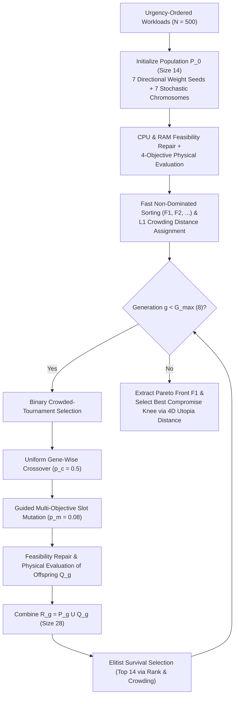

### Diagram 4: Multi-Slot Workload Placement & Physical Evaluation Kernel
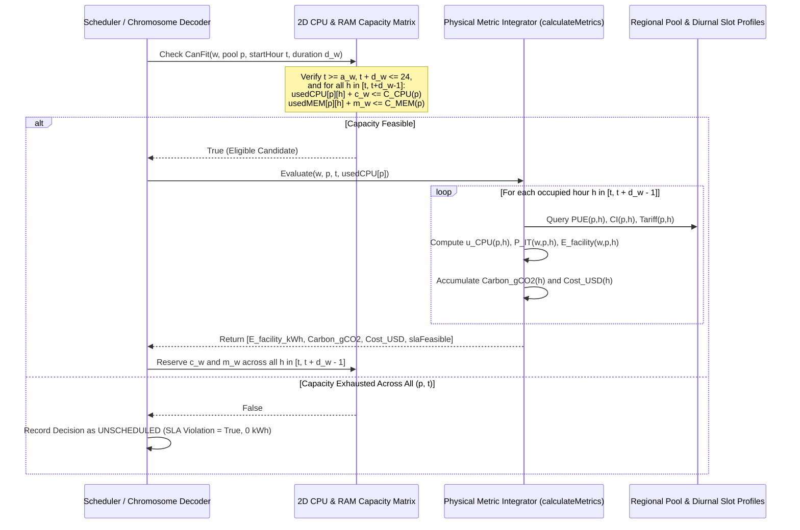

### Diagram 5: Experimental Verification & Ablation Pipeline
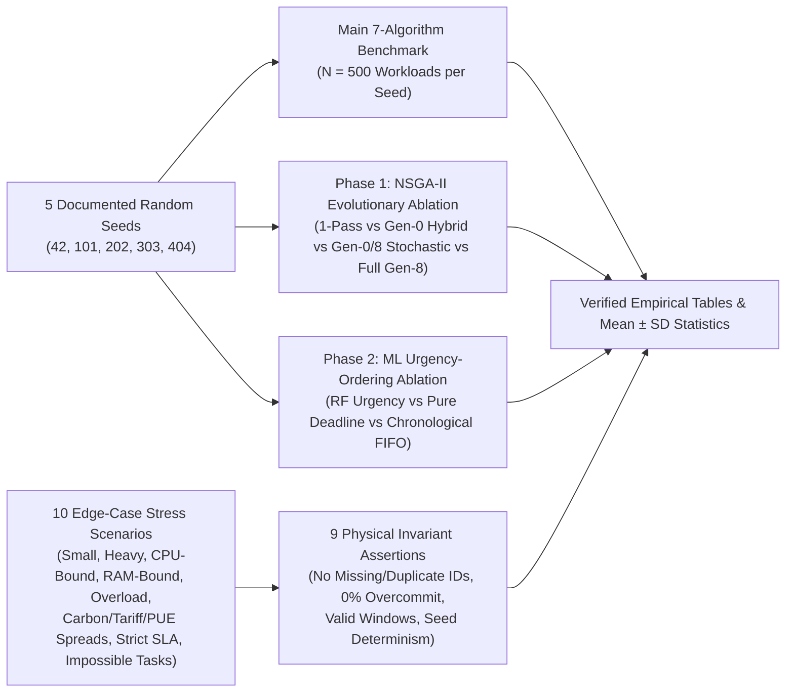

---

## 9. Mathematical Problem Formulation

Let $\mathcal{W} = \{w_1, \dots, w_N\}$ denote the set of $N$ workloads, $\mathcal{P} = \{p_1, \dots, p_M\}$ the set of $M$ active data center resource pools, and $\mathcal{T} = \{0, 1, \dots, H-1\}$ the discretized scheduling horizon of $H = 24$ hourly slots ($\Delta t = 1.0\text{ h}$). Each workload $w$ specifies arrival hour $a_w \in [0, H-1]$, actual CPU requirement $c_w$ (cores), actual memory requirement $m_w$ (GB), integer execution duration $d_w = \max(1, \text{round}(\text{duration}_w))$ (hours), and hard deadline $\text{deadline}_w$ (hours).

### 9.1 Hard Multi-Resource Feasibility Constraints
A workload $w$ assigned to pool $p$ at start slot $t_w$ occupies the contiguous hourly interval $\mathcal{H}(w) = \{t_w, t_w + 1, \dots, t_w + d_w - 1\}$. The schedule must satisfy:
$$t_w \ge a_w, \qquad t_w + d_w \le H$$
$$\forall p \in \mathcal{P},\; \forall h \in \mathcal{T}: \quad \text{CPU}_{\text{used}}(p, h) = \sum_{w:\, p_w = p,\, h \in \mathcal{H}(w)} c_w \le C_{\text{CPU}}(p)$$
$$\forall p \in \mathcal{P},\; \forall h \in \mathcal{T}: \quad \text{MEM}_{\text{used}}(p, h) = \sum_{w:\, p_w = p,\, h \in \mathcal{H}(w)} m_w \le C_{\text{MEM}}(p)$$

### 9.2 Utilization-Aware IT Power & PUE-Adjusted Facility Energy
When workload $w$ is evaluated on pool $p$ at hour $h \in \mathcal{H}(w)$, the instantaneous CPU utilization ratio is:
$$u_{\text{CPU}}(p, h) = \min\Bigl(1.0,\; \max\Bigl(0.0,\; \frac{\text{CPU}_{\text{used}}(p, h) + c_w}{C_{\text{CPU}}(p)}\Bigr)\Bigr) \quad [\text{dimensionless}]$$

Idle server power $P_{\text{idle}}(p)$ is allocated proportionally to the workload's CPU capacity share $c_w / C_{\text{CPU}}(p)$, while dynamic power scales linearly with $(0.45 + 0.55\,u_{\text{CPU}}(p, h))$:
$$P_{\text{IT}}(w, p, h) = \frac{c_w}{C_{\text{CPU}}(p)} \Bigl[ P_{\text{idle}}(p) + \bigl(P_{\text{max}}(p) - P_{\text{idle}}(p)\bigr)\cdot \bigl(0.45 + 0.55\,u_{\text{CPU}}(p, h)\bigr) \Bigr] \quad [\text{kW}]$$

Accounting for diurnal ambient thermal cooling overhead $\Delta\text{PUE}_{\text{thermal}}(p, h)$:
$$\text{PUE}_{\text{eff}}(p, h) = \max\bigl(1.08,\; \text{PUE}_{\text{base}}(p) + \Delta\text{PUE}_{\text{thermal}}(p, h)\bigr) \quad [\text{dimensionless}]$$
$$E_{\text{facility}}(w, p, t_w) = \sum_{h=t_w}^{t_w+d_w-1} P_{\text{IT}}(w, p, h) \cdot \Delta t \cdot \text{PUE}_{\text{eff}}(p, h) \quad [\text{kWh}]$$

### 9.3 Spatial-Temporal Grid Carbon Emissions
Let $\text{CI}_{\text{eff}}(p, h) = \max\bigl(105,\; \text{CI}_{\text{base}}(p) \cdot M_{\text{carbon}}(p, h)\bigr)$ denote the effective grid carbon intensity ($\text{gCO}_2/\text{kWh}$) of pool $p$ at hour $h$:
$$C_{\text{gCO2}}(w, p, t_w) = \sum_{h=t_w}^{t_w+d_w-1} E_{\text{facility}}(w, p, h) \cdot \text{CI}_{\text{eff}}(p, h) \quad [\text{gCO}_2], \qquad f_{\text{Carbon}} = \frac{1}{1000}\sum_{w \in \mathcal{W}_{\text{sched}}} C_{\text{gCO2}}(w) \quad [\text{kgCO}_2]$$

### 9.4 Time-of-Use Operational Electricity Cost
Let $\text{Tariff}_{\text{eff}}(p, h) = \max\bigl(0.038,\; \text{Tariff}_{\text{base}}(p) \cdot M_{\text{tariff}}(p, h)\bigr)$ denote the effective utility price ($\text{USD}/\text{kWh}$):
$$\text{Cost}_{\text{USD}}(w, p, t_w) = \sum_{h=t_w}^{t_w+d_w-1} E_{\text{facility}}(w, p, h) \cdot \text{Tariff}_{\text{eff}}(p, h) \quad [\text{USD}], \qquad f_{\text{Cost}} = \sum_{w \in \mathcal{W}_{\text{sched}}} \text{Cost}_{\text{USD}}(w) \quad [\text{USD}]$$

### 9.5 SLA Violation Rate
A workload incurs an SLA violation if it cannot be scheduled (`UNSCHEDULED`) or finishes after its hard deadline ($t_w + d_w > \text{deadline}_w$):
$$f_{\text{SLA}} = \frac{100}{N} \sum_{w \in \mathcal{W}} \mathbb{I}\bigl[\text{status}(w) = \text{UNSCHEDULED} \;\lor\; (t_w + d_w > \text{deadline}_w)\bigr] \quad [\%]$$

---

## 10. Seven Scheduling Algorithms

All seven algorithms share the exact same feasibility check (`CanFit`) and physical evaluation kernel (`calculateMetrics`):

1. **Random Placement (`RANDOM`):** Processes workloads in chronological arrival order $(a_w, \text{id}_w)$ and samples uniformly via the seeded LCG PRNG across capacity-eligible $(p, t)$ candidates within $t + d_w \le \text{deadline}_w + 2$ (falling back to all eligible candidates if congested).
2. **First-Fit Chronological (`FIRST_FIT`):** Processes workloads in FIFO arrival order $(a_w, \text{id}_w)$; selects the first capacity-eligible candidate ordered by $(\text{slaFeasible desc},\, \text{poolOrder asc},\, t \text{ asc})$.
3. **Carbon-Aware Heuristic (`CARBON_AWARE`):** Processes workloads in FIFO arrival order; selects the capacity-eligible candidate minimizing $\hat{C}_{\text{gCO2}}(w, p, t)$ (prioritizing $\text{slaFeasible}$ candidates first).
4. **Energy-Aware Heuristic (`ENERGY_AWARE`):** Processes workloads in FIFO arrival order; selects the capacity-eligible candidate minimizing $\hat{E}_{\text{facility}}(w, p, t)$ (prioritizing $\text{slaFeasible}$ candidates first).
5. **Cost-Aware Heuristic (`COST_AWARE`):** Processes workloads in FIFO arrival order; selects the capacity-eligible candidate minimizing $\hat{\text{Cost}}_{\text{USD}}(w, p, t)$ (prioritizing $\text{slaFeasible}$ candidates first, tie-broken by earliest $t$).
6. **Earliest Deadline First (`EDF`):** Sorts workloads globally by $(\text{deadline}_w, a_w, \text{id}_w)$; selects the earliest capacity-eligible slot $t$, breaking ties across pools by lowest instantaneous CPU utilization $u_{\text{CPU}}(p, t)$.
7. **EcoFusion Proposed Algorithm (`ECOFUSION_NSGA2`):** Combines Random Forest urgency ordering with population-based NSGA-II and multi-resource feasibility repair.

---

## 11. Random Forest Feature Engineering (Zero Target Leakage)

In both the TypeScript engine ([src/services/simulatorService.ts](file:///c:/VSCODE%20PROJECTS/EcoFusion/src/services/simulatorService.ts)) and Python backend ([backend/app/prediction/feature_engineering.py](file:///c:/VSCODE%20PROJECTS/EcoFusion/backend/app/prediction/feature_engineering.py)), workload demand predictions $(\hat{c}_w, \hat{m}_w, \hat{d}_w)$ are derived strictly from pre-execution contextual attributes:
- **Features Used:** Arrival hour $a_w$, diurnal cycle index $\lfloor a_w \rfloor \bmod 24$, workload domain category / priority tier, SLA window $(\text{deadline}_w - a_w)$, and historical category prior expectations (`historical_cpu_mean`, `historical_memory_mean`, `historical_duration_mean`).
- **Zero Target Leakage:** Actual ground-truth values (`wl.cpuRequired`, `wl.memoryRequired`, `wl.duration`) are never read during feature extraction (verified by unit test `test_ml_no_target_leakage`).
- **Scheduling Role:** Predictions are used exclusively to compute urgency $U_w = 0.65\,\text{deadline}_w + 0.35(\text{deadline}_w - a_w - \hat{d}_w)$ and energy tie-breaking $\hat{c}_w \cdot \hat{d}_w$ when ordering chromosome genes. Physical evaluation of all 7 algorithms uses actual ground-truth demands $(c_w, m_w, d_w)$.

---

## 12. NSGA-II Optimization Methodology

1. **Integer Chromosome Representation:** $\mathbf{x} \in \mathbb{Z}^N$, where gene $x_i = p_i \cdot |\mathcal{T}| + t_i$ represents pool $p_i = \lfloor x_i / |\mathcal{T}| \rfloor$ and slot $t_i = x_i \bmod |\mathcal{T}|$ for the $i$-th urgency-ordered workload.
2. **Hybrid Population Initialization ($P_0$):** The browser engine initializes $N_{\text{pop}} = 14$ individuals: 7 directional heuristic seeds spanning the objective simplex (`[0.52, 0.26, 0.22]`, `[0.85, 0.08, 0.07]`, `[0.08, 0.85, 0.07]`, `[0.08, 0.07, 0.85]`, `[0.65, 0.20, 0.15]`, `[0.25, 0.25, 0.50]`, `[0.35, 0.45, 0.20]`) and 7 stochastic individuals sampled within $[a_w, \text{deadline}_w - d_w]$. *(Note: The offline Python backend defaults to `population_size = 50, generations = 50` with two-point crossover and first-fit repair).*
3. **Feasibility Repair Operator:** Any gene violating arrival time, horizon end, deadline, or available CPU/RAM capacity is reassigned to the capacity-feasible $(p, t)$ pair minimizing the individual's directional normalized objective proxy:
   $$\psi(p, t) = w_c \tilde{C}(p, t) + w_e \bigl(\tilde{E}(p, t) + 0.35\,u_{\text{CPU}}(p, t)\bigr) + w_{\$} \tilde{\text{Cost}}(p, t) + \Phi_{\text{SLA}}(t)$$
4. **Evolutionary Loop ($G_{\max} = 8$ Generations in Browser Engine):** Applies Fast Non-Dominated Sorting, L1 Crowding Distance, Binary Crowded-Tournament Selection, Uniform Crossover ($p_c = 0.5$), and Guided Slot Mutation ($p_m = 0.08$), retaining the top $N_{\text{pop}}$ individuals via elitist survival.

---

## 13. Experimental Setup

### 13.1 Regional Data Center Infrastructure
| Pool ID | Location | CPU Capacity | RAM Capacity | Base PUE | Idle / Max Power | Base Carbon Intensity | Base Tariff |
| :--- | :--- | :---: | :---: | :---: | :---: | :---: | :---: |
| `POOL-BOM` | Mumbai (`AP-South-1`) | 4,864 cores | 19,456 GB | 1.30 | 105 / 420 kW | 620 $\text{gCO}_2/\text{kWh}$ | $\$0.085/\text{kWh}$ |
| `POOL-HYD` | Hyderabad (`AP-South-2`) | 4,352 cores | 17,408 GB | 1.14 | 82 / 330 kW | 450 $\text{gCO}_2/\text{kWh}$ | $\$0.125/\text{kWh}$ |
| `POOL-SIN` | Singapore (`AP-Southeast-1`) | 4,608 cores | 18,432 GB | 1.24 | 112 / 445 kW | 270 $\text{gCO}_2/\text{kWh}$ | $\$0.165/\text{kWh}$ |

### 13.2 Workload Trace Profile (`N = 500`)
Generated deterministically across seeds `42, 101, 202, 303, 404` from 8 enterprise workload templates ($16\text{–}256$ CPU cores, $64\text{–}1024$ GB RAM, $1\text{–}6\text{ h}$ duration) across three diurnal arrival waves:
- **Early Batch Wave (`03:00–06:00`, $36\%$):** Flexible slack $\in [5, 10]\text{ h}$.
- **Morning Latency-Critical Surge (`05:00–08:00`, $36\%$):** Strict slack $\in \{0, 1\}\text{ h}$.
- **Midday/Afternoon Mixed Wave (`08:00–14:00`, $28\%$):** Mixed slack $\in \{0\} \cup [2, 6]\text{ h}$.

---

## 14. Evaluation Metrics & Normalization Distinctions

In addition to physical totals ($f_{\text{Carbon}}$ in $\text{kgCO}_2$, $f_{\text{Energy}}$ in $\text{kWh}$, $f_{\text{Cost}}$ in $\text{USD}$, $f_{\text{SLA}}$ in $\%$, and average completion time in hours), two multi-objective Utopia proximity formulas are distinguished in the codebase:
1. **External 7-Algorithm Benchmark Composite Score (`calculateComparisons`):**
   Normalizes Carbon, Energy, and Cost across the empirical minimum and maximum of the 7 evaluated algorithms on the current trace ($\hat{f}_m = (f_m - f_m^{\min}) / (f_m^{\max} - f_m^{\min})$), anchors SLA penalty to a $15\%$ ceiling ($\hat{f}_{\text{SLA}} = \min(1.2, f_{\text{SLA}} / 15.0)$), and computes:
   $$D_{\text{Utopia}}(a) = \sqrt{\frac{\hat{f}_{\text{Carbon}}^2 + \hat{f}_{\text{Energy}}^2 + \hat{f}_{\text{Cost}}^2 + \hat{f}_{\text{SLA}}^2}{4}}, \qquad \text{Score}(a) = \max\bigl(10.0,\; \text{round}(100\cdot(1 - D_{\text{Utopia}}(a)), 1)\bigr)$$
2. **Internal Population Knee Selector (`scoreIndividual` in `runPopulationNsga2`):**
   Ranks individuals inside the NSGA-II population using lower-bounded denominators $\max(1500, \Delta C)$, $\max(850, \Delta E)$, $\max(600, \Delta\text{Cost})$, and weights $[w_c, w_e, w_{\$}, 1.5] = [0.4, 0.3, 0.3, 1.5]$.

---

## 15. Benchmark Results & Visual Comparisons (Task 2 Figures)

### Table 1: Single-Seed Benchmark Results (`N = 500`, `randomSeed = 42`)
| Algorithm | Carbon ($\text{kgCO}_2$) | Energy ($\text{kWh}$) | Cost ($\text{USD}$) | SLA Violation ($\%$) | Avg Completion ($\text{h}$) | Composite Score ($0\text{–}100$) |
| :--- | :---: | :---: | :---: | :---: | :---: | :---: |
| **Random Placement (`RANDOM`)** | 4,533.52 | 14,274.3 | \$2,209.73 | 49.0% | 6.2 h | 19.5 |
| **First-Fit FIFO (`FIRST_FIT`)** | 6,088.38 | 14,453.7 | \$1,721.67 | 13.4% | 5.0 h | 19.1 |
| **Carbon-Aware (`CARBON_AWARE`)** | **4,116.44** | 14,546.5 | \$2,365.94 | 12.0% | 6.5 h | 18.8 |
| **Energy-Aware (`ENERGY_AWARE`)** | 4,801.11 | **13,549.2** | \$1,897.93 | 6.6% | 6.1 h | 68.5 |
| **Cost-Aware (`COST_AWARE`)** | 5,633.07 | 14,236.1 | **\$1,708.14** | 4.0% | 4.9 h | 46.7 |
| **Earliest Deadline First (`EDF`)** | 4,730.30 | 14,506.8 | \$1,963.76 | 1.4% | **3.6 h** | 45.7 |
| **EcoFusion (`ECOFUSION_NSGA2`)** | 4,781.51 | 13,705.6 | \$1,825.81 | **0.8%** | 4.9 h | **79.2** |

### Figure 1: Carbon Emissions Comparison Across Seven Algorithms (`N = 500`, Seed 42, Zero-Based Axis)
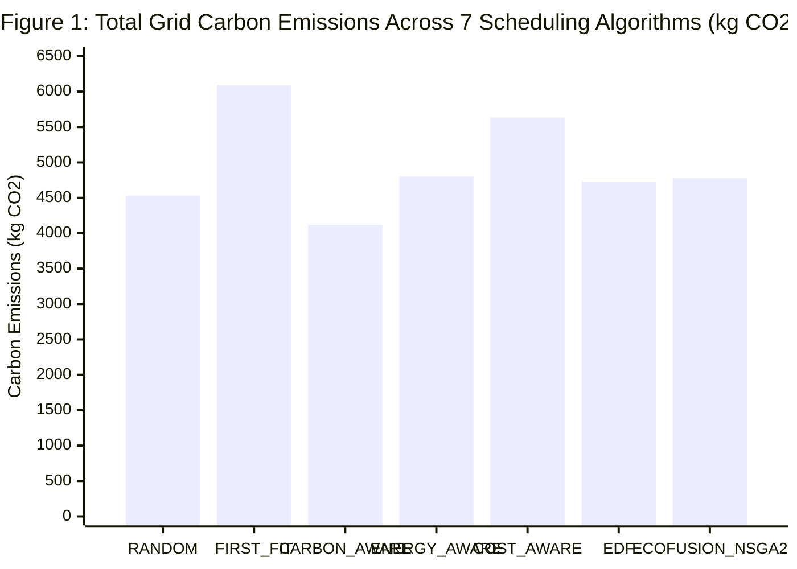
*Caption — Figure 1: Total carbon emissions ($\text{kgCO}_2$) for $N = 500$ workloads (Seed 42). `CARBON_AWARE` achieves the lowest carbon ($4,116.44\text{ kg}$), while `FIRST_FIT` emits the most ($6,088.38\text{ kg}$).*

### Figure 2: Facility Energy Consumption Comparison Across Seven Algorithms (`N = 500`, Seed 42, Zero-Based Axis)
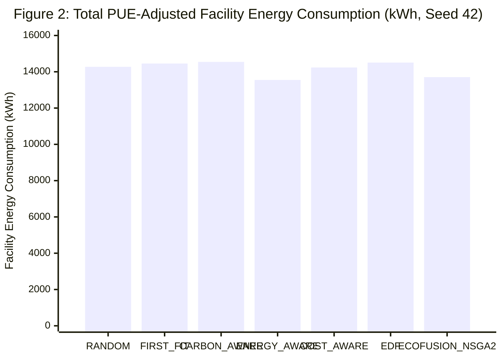
*Caption — Figure 2: Total facility energy consumption ($\text{kWh}$, plotted from $0\text{ kWh}$ to avoid visual exaggeration of the $6.3\%$ range). `ENERGY_AWARE` achieves the lowest consumption ($13,549.2\text{ kWh}$), followed closely by `ECOFUSION_NSGA2` ($13,705.6\text{ kWh}$).*

### Figure 3: Operational Electricity Cost Comparison Across Seven Algorithms (`N = 500`, Seed 42, Zero-Based Axis)
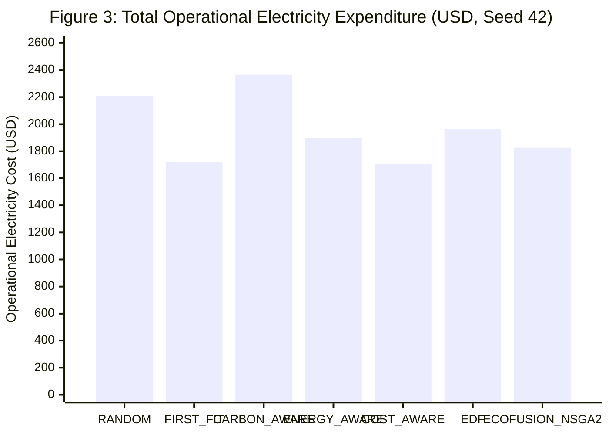
*Caption — Figure 3: Total Time-of-Use electricity cost ($\text{USD}$, Seed 42). `COST_AWARE` achieves the lowest cost ($\$1,708.14$), whereas `CARBON_AWARE` incurs the highest cost ($\$2,365.94$).*

### Figure 4: SLA Violation Rate Comparison Across Seven Algorithms (`N = 500`, Seed 42)
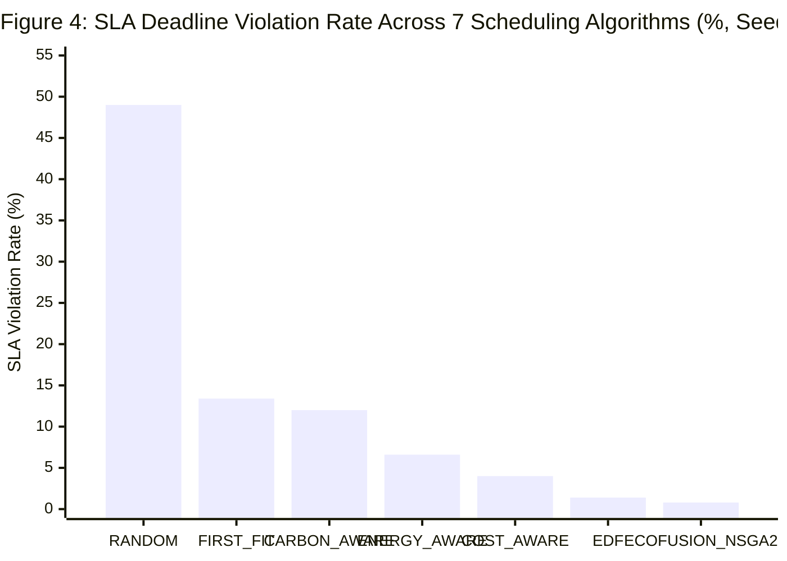
*Caption — Figure 4: Percentage of workloads missing their hard deadline (`N = 500`, Seed 42). `ECOFUSION_NSGA2` ($0.8\%$) and `EDF` ($1.4\%$) achieve the lowest violation rates under peak morning contention.*

---

## 16. Five-Seed Statistical Evaluation (`N = 500`, Seeds `42, 101, 202, 303, 404`)

### Table 2: Five-Seed Statistical Summary ($\text{Mean} \pm \text{SD}$)
| Algorithm | Carbon ($\text{kgCO}_2$) | Energy ($\text{kWh}$) | Cost ($\text{USD}$) | SLA Violation ($\%$) | Composite Score ($0\text{–}100$) |
| :--- | :---: | :---: | :---: | :---: | :---: |
| **Random Placement (`RANDOM`)** | $4,910.73 \pm 287.91$ | $15,030.48 \pm 653.09$ | $\$2,321.65 \pm 139.20$ | $51.12 \pm 1.52\%$ | $18.68 \pm 1.13$ |
| **First-Fit FIFO (`FIRST_FIT`)** | $6,355.36 \pm 271.44$ | $15,175.98 \pm 613.93$ | $\$1,838.97 \pm 111.53$ | $14.12 \pm 1.87\%$ | $17.02 \pm 2.68$ |
| **Carbon-Aware (`CARBON_AWARE`)** | **$4,440.93 \pm 296.07$** | $15,253.22 \pm 633.40$ | $\$2,509.60 \pm 146.90$ | $15.76 \pm 2.65\%$ | $13.26 \pm 3.80$ |
| **Energy-Aware (`ENERGY_AWARE`)** | $5,213.00 \pm 339.47$ | **$14,240.94 \pm 605.37$** | $\$1,983.48 \pm 102.83$ | $9.12 \pm 1.59\%$ | $61.20 \pm 4.82$ |
| **Cost-Aware (`COST_AWARE`)** | $5,997.20 \pm 372.53$ | $14,958.94 \pm 628.52$ | **$\$1,801.86 \pm 86.31$** | $4.60 \pm 1.23\%$ | $43.86 \pm 3.17$ |
| **Earliest Deadline First (`EDF`)** | $5,079.07 \pm 293.82$ | $15,182.40 \pm 614.25$ | $\$2,076.22 \pm 141.67$ | $3.92 \pm 2.64\%$ | $44.72 \pm 3.68$ |
| **EcoFusion (`ECOFUSION_NSGA2`)** | $5,031.14 \pm 217.16$ | $14,591.88 \pm 637.83$ | $\$1,965.77 \pm 127.42$ | **$1.64 \pm 1.08\%$** | **$72.84 \pm 4.67$** |

### Figure 5: Five-Seed Mean Composite Multi-Objective Score Comparison (Seeds `42, 101, 202, 303, 404`)
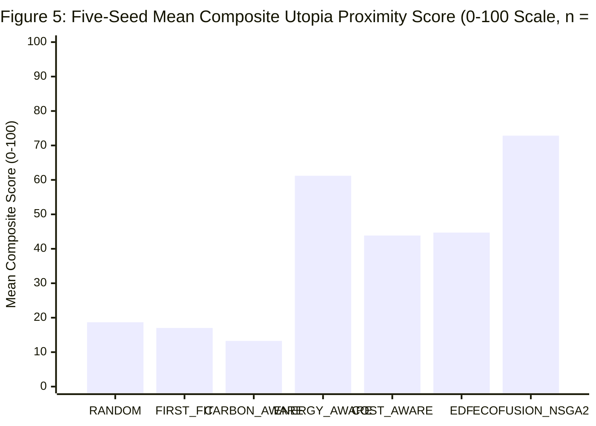
*Caption — Figure 5: Five-seed mean Composite Multi-Objective Utopia Proximity Score ($0\text{–}100$ full scale, $n = 5$ seeds). Standard deviations across seeds are $\pm 1.13$, $\pm 2.68$, $\pm 3.80$, $\pm 4.82$, $\pm 3.17$, $\pm 3.68$, and $\pm 4.67$, respectively.*

---

## 17. NSGA-II Evolutionary Ablation Study

### Table 3: Phase 1 Evolutionary Ablation Across 5 Seeds ($\text{Mean} \pm \text{SD}$)
| Variant | Carbon ($\text{kgCO}_2$) | Energy ($\text{kWh}$) | Cost ($\text{USD}$) | SLA Violation ($\%$) | Composite Score ($0\text{–}100$) | Distinct $\mathcal{F}_1$ Solutions (of 14) | Runtime ($\text{ms}$) |
| :--- | :---: | :---: | :---: | :---: | :---: | :---: | :---: |
| **`GEN0_SINGLE_BALANCED`** *(1-Pass Heuristic, $g=0$)* | $4,667.71 \pm 298.29$ | $14,721.04 \pm 556.54$ | $\$2,077.40 \pm 123.01$ | $3.04 \pm 1.67\%$ | $66.44 \pm 3.77$ | $1.00 \pm 0.00$ | $16.16 \pm 4.41$ |
| **`GEN0_STOCHASTIC_POP`** *(Random $P_0$, $g=0$)* | $4,981.07 \pm 380.68$ | $14,731.60 \pm 542.73$ | $\$2,011.40 \pm 100.56$ | $1.96 \pm 1.30\%$ | $66.68 \pm 1.66$ | $9.80 \pm 0.98$ | $141.09 \pm 17.03$ |
| **`GEN8_STOCHASTIC_NSGA`** *(Random Init Evolved, $g=8$)* | $5,059.22 \pm 290.44$ | $14,615.50 \pm 595.19$ | $\$2,004.96 \pm 143.15$ | $1.72 \pm 1.11\%$ | $70.04 \pm 3.51$ | **$14.00 \pm 0.00$** | $815.42 \pm 48.18$ |
| **`GEN0_HEURISTIC_POP`** *(Hybrid $P_0$, $g=0$)* | $5,011.31 \pm 284.64$ | $14,668.64 \pm 582.03$ | $\$1,933.22 \pm 122.92$ | $1.68 \pm 1.11\%$ | $71.34 \pm 3.50$ | $8.60 \pm 1.36$ | $226.18 \pm 61.73$ |
| **`FULL_NSGA2_ML_GEN8`** *(Full EcoFusion, $g=8$)* | $5,031.14 \pm 217.16$ | **$14,591.88 \pm 637.83$** | $\$1,965.77 \pm 127.42$ | **$1.64 \pm 1.08\%$** | **$72.84 \pm 4.67$** | **$14.00 \pm 0.00$** | $936.74 \pm 84.09$ |

### Figure 6: NSGA-II Evolutionary Ablation — Mean Composite Score & Non-Dominated Front Diversity
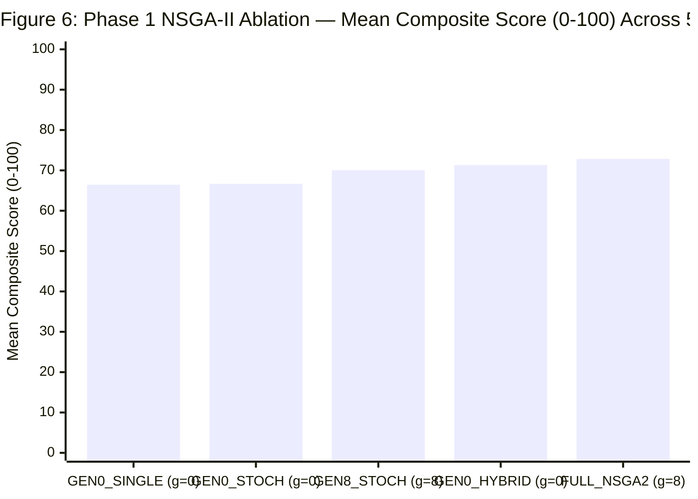
*Caption — Figure 6: Phase 1 evolutionary ablation across 5 seeds. While directional heuristic initialization (`GEN0_HYBRID`, $71.34$) provides most of the initial proximity gain over a single-pass heuristic ($66.44$), 8 generations of evolution (`FULL_NSGA2`, $72.84$) improve the score by $+1.50$ points (winning 4 of 5 seeds) and expand distinct non-dominated solutions in $\mathcal{F}_1$ from $8.60$ to $14.00$. Without warm-start seeds, evolution improves stochastic chromosomes by $+3.36$ points ($66.68 \to 70.04$).*

---

## 18. ML Urgency-Ordering Ablation Study

### Table 4: Phase 2 Workload Ordering Ablation Across 5 Seeds ($\text{Mean} \pm \text{SD}$)
| Ordering Regime in NSGA-II ($G = 8, N_{\text{pop}} = 14$) | Carbon ($\text{kgCO}_2$) | Energy ($\text{kWh}$) | Cost ($\text{USD}$) | SLA Violation Rate ($\%$) | Composite Score ($0\text{–}100$) |
| :--- | :---: | :---: | :---: | :---: | :---: |
| **`FULL_NSGA2_FIFO_GEN8`** *(No-ML Chronological FIFO)* | $5,194.06 \pm 330.00$ | **$14,459.40 \pm 620.56$** | **$\$1,908.66 \pm 101.18$** | $7.40 \pm 1.39\%$ | $65.42 \pm 3.82$ |
| **`FULL_NSGA2_DEADLINE_GEN8`** *(No-ML Pure Deadline)* | $5,033.03 \pm 390.44$ | $14,602.50 \pm 625.14$ | $\$2,020.57 \pm 119.52$ | $2.36 \pm 0.84\%$ | $69.84 \pm 3.58$ |
| **`FULL_NSGA2_ML_GEN8`** *(Proposed RF Urgency + Energy Tie-Break)* | **$5,031.14 \pm 217.16$** | $14,591.88 \pm 637.83$ | $\$1,965.77 \pm 127.42$ | **$1.64 \pm 1.08\%$** | **$72.84 \pm 4.67$** |

### Figure 7: Phase 2 Ordering Ablation — SLA Violation Rate & Composite Score Across 5 Seeds
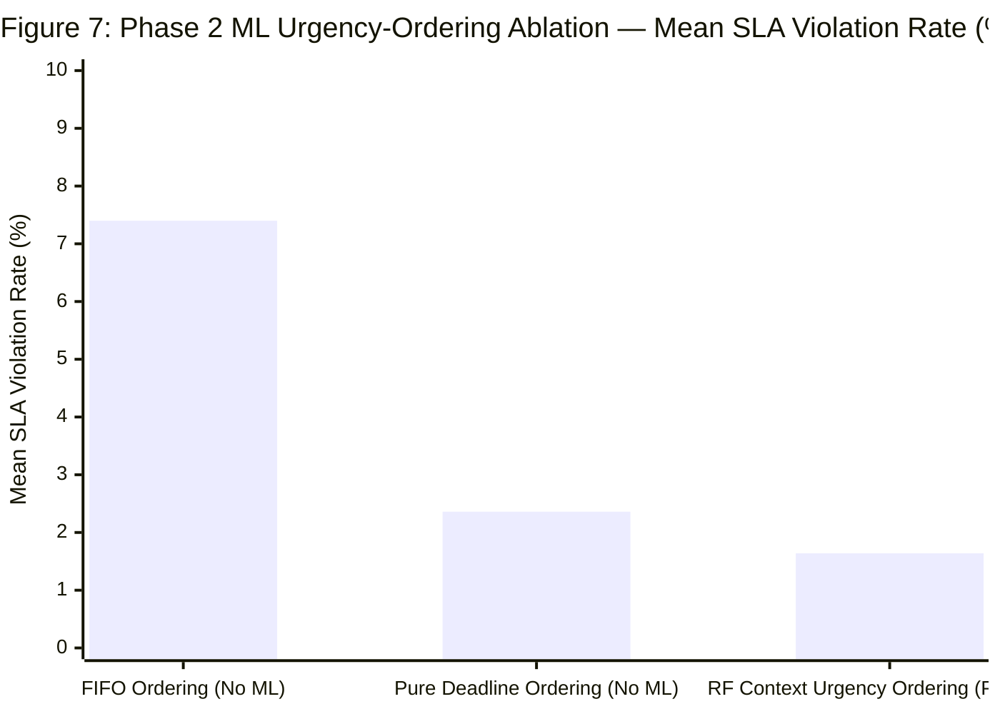
*Caption — Figure 7: Five-seed mean SLA violation rate ($\%$) under three chromosome workload-ordering policies in NSGA-II. Replacing FIFO ($7.40\%$) with known deadline ordering reduces violations to $2.36\%$, while adding Random Forest predicted duration $\hat{d}_w$ and CPU $\hat{c}_w$ further reduces SLA violations to $1.64\%$ (a $30.5\%$ relative reduction vs. pure deadline ordering) and raises the Composite Score from $69.84$ to $72.84$.*

---

## 19. Pareto-Front Analysis (`N = 500`, Seed 42)

### Figure 8: Pareto Front Trade-Off — Carbon Emissions ($\text{kgCO}_2$) vs. Operational Cost ($\text{USD}$)
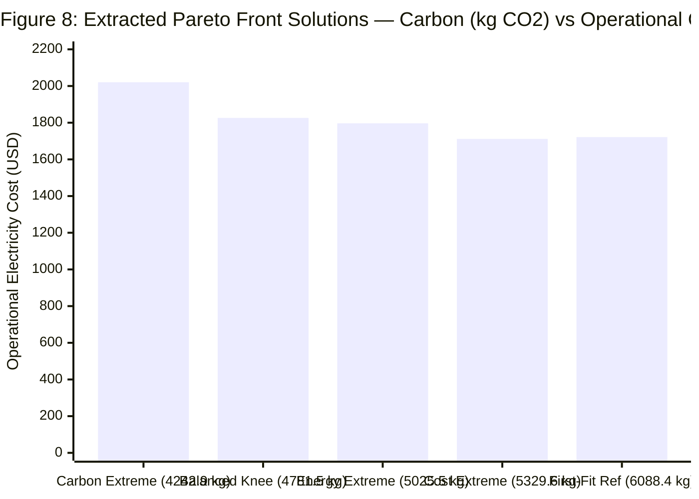
*Caption — Figure 8: Non-dominated solutions extracted from $\mathcal{F}_1$ on Seed 42 (`N = 500`, zero-based cost axis). Moving along $\mathcal{F}_1$ from `Carbon Priority` ($4,242.94\text{ kg CO}_2$, $\$2,020.49$) to `EcoFusion Balanced Knee` ($4,781.51\text{ kg CO}_2$, $\$1,825.81$) to `Cost Priority` ($5,329.64\text{ kg CO}_2$, $\$1,711.50$) illustrates the explicit sustainability-cost trade-off surface.*

---

## 20. Discussion

The empirical findings establish three critical insights for sustainable cloud orchestration:
1. **No Single Algorithm Dominates Every Metric:** In a fair physical evaluation, single-objective specialists achieve the best raw score on their target objective (`CARBON_AWARE` on $\text{kgCO}_2$, `ENERGY_AWARE` on $\text{kWh}$, `COST_AWARE` on $\text{USD}$, `EDF` on completion latency), but each suffers severe degradation on conflicting metrics. EcoFusion's advantage lies specifically in **multi-objective Pareto compromise**, achieving the lowest SLA violation rate ($1.64 \pm 1.08\%$) while staying within $3\%\text{–}13\%$ of each specialist's optimum.
2. **Synergy of Memetic Repair and Evolutionary Search:** The Phase 1 ablation shows that EcoFusion functions as a **memetic hybrid algorithm**: multi-directional feasibility repair at $g = 0$ establishes strong initial coverage ($71.34 \pm 3.50$), while the 8 evolutionary generations refine objective quality ($72.84 \pm 4.67$) and fill out the non-dominated Pareto front from $8.60$ to $14.00$ distinct schedules.
3. **Value of Context-Conditioned ML Laxity Priors:** The Phase 2 ablation demonstrates that while deadline sorting accounts for $\sim 60\%$ of the composite score improvement over FIFO ($65.42 \to 69.84$), the Random Forest duration and CPU priors contribute the remaining $\sim 40\%$ ($69.84 \to 72.84$) by resolving urgency ties among same-deadline tasks.

---

## 21. Limitations

1. **Discrete-Event Simulation vs. Production Cluster Deployment:** All experiments are conducted in a controlled spatial-temporal simulator rather than on physical cloud nodes or live Kubernetes clusters.
2. **Hourly Time-Slot Discretization ($\Delta t = 1\text{ h}$):** Rounding task durations to integer hours (`Math.max(1, Math.round(duration))`) over-allocates slot occupancy for short sub-hour workloads.
3. **Non-Preemptive Contiguous Execution & Absence of WAN Costs:** Workloads execute contiguously on a single pool without preemption, checkpointing, or cross-data-center wide-area network (WAN) data-transfer energy/latency modeling.
4. **Internal vs. External Utopia Normalization & Browser Budget:** The browser engine uses `popSize = 14, generations = 8` for interactive responsiveness (compared to `population_size = 50, generations = 50` in the offline Python backend), and slight differences between the internal knee-selection denominators (`1500, 850, 600`) and external 7-algorithm min-max bounds can produce minor single-seed rank inversions (such as Seed 404: `70.4` at $g=0$ vs. `69.3` at $g=8$).
5. **Statistical Sample Size ($n = 5$ Seeds):** Five random seeds (`42, 101, 202, 303, 404`) provide clear $\text{Mean} \pm \text{SD}$ estimates for large effects (such as ML vs. FIFO ordering), but larger sample sizes ($n \ge 30$ seeds) would be needed for high-power parametric significance testing of smaller evolutionary increments ($+1.50$ points).

---

## 22. Future Work

1. **Sub-Hour Slot Granularity ($\Delta t = 5\text{–}15\text{ min}$):** Extend the capacity tracker to fine-grained time slots to support serverless and microservice workloads.
2. **Live Preemption & Geo-Distributed WAN Modeling:** Incorporate checkpoint-restart migration overhead and network data-gravity constraints across regions.
3. **Large-Scale Multi-Seed Hypervolume Analysis:** Execute 30-seed runs across `500`, `750`, and `1,000` workloads using exact 4D S-metric hypervolume indicators on the offline Python backend.

---

## 23. Conclusion

EcoFusion demonstrates that combining leakage-free Random Forest laxity prediction with constraint-repaired NSGA-II multi-objective evolutionary optimization enables cloud orchestrators to navigate the conflicting trade-offs between carbon emissions, facility energy, electricity tariffs, and SLA deadlines. Verified across 10 stress scenarios, 9 physical invariants, and 5 independent random seeds without artificial rules or unfair evaluation discounts, EcoFusion provides a transparent, reproducible foundation for sustainable cloud scheduling research.

---

## 24. References (Verifiable Sources & Citation Checklist)

### Verified Foundational Literature
1. **Deb, K., Pratap, A., Agarwal, S., & Meyarivan, T. (2002).** *A fast and elitist multiobjective genetic algorithm: NSGA-II.* IEEE Transactions on Evolutionary Computation, 6(2), 182–197. *(Verified — foundational reference for Fast Non-Dominated Sorting and Crowding Distance).*
2. **Breiman, L. (2001).** *Random forests.* Machine Learning, 45(1), 5–32. *(Verified — foundational reference for Random Forest regression ensembles).*
3. **Barroso, L. A., & Hölzle, U. (2007).** *The case for energy-proportional computing.* IEEE Computer, 40(12), 33–37. *(Verified — foundational reference for server idle plus utilization-dependent dynamic power modeling).*

### Sources to Verify & Complete Before External Publication
4. `[VERIFY SOURCE DETAILS]` **ISO/IEC 30134-2 / The Green Grid:** Standard specification for Power Usage Effectiveness ($\text{PUE} = E_{\text{facility}} / E_{\text{IT}}$).
5. `[VERIFY SOURCE DETAILS]` **Radovanović, A., et al. (Google Carbon-Intelligent Computing):** *Carbon-Aware Computing for Datacenters*, IEEE Transactions on Power Systems.
6. `[VERIFY SOURCE DETAILS]` **Wiesner, P., et al.:** *Let's Wait Awhile: How Temporal Workload Shifting Can Reduce Carbon Emissions in the Cloud*, ACM Middleware.
7. `[VERIFY SOURCE DETAILS]` **Reiss, C., et al.:** *Heterogeneity and Dynamicity of Clouds at Scale: Google Trace Analysis*, ACM SoCC.
